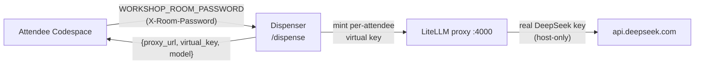

# Host runbook (facilitator)

> **Audience:** the person *running* an instructor-led delivery, not attendees.
> Ported from Henrik Rexed's upstream (ISI-7001). The proxy is **optional** in
> this edition: without it attendees fall back to their own `DEEPSEEK_API_KEY`
> or the in-cluster Ollama model. In the Dynatrace Enablement App learners type
> the two values into `useWorkshopModel` (next section).
> Attendees supply only `WORKSHOP_ROOM_PASSWORD` and `WORKSHOP_DISPENSER_URL`.

## Enablement App delivery (COE / production): the shared Qwen3-32B box

For a trainer-led delivery in the Dynatrace Enablement App the room runs on
**one shared GPU box** (`g7e.2xlarge`, vLLM `Qwen/Qwen3-32B-FP8` served as
`qwen3-32b`, LiteLLM per-learner keys, the same room-password dispenser
contract as below). It is launched **on demand** by the platform operator for
the delivery and terminated after it. The operator commands, measurements and
guarantees live in the tooling repo: `tools/llm-box/README.md`
(`dynatrace-wwse/enablement-framework-tooling`), section *Production delivery*.

| When | Who | What |
|---|---|---|
| ≥ 30 min before start (cold start ≈ 18 min) | operator | launch the box `--on-demand`, bootstrap, run `ready.sh` until it prints `READY` |
| before start | operator → trainer | dispenser URL (`https://<ip>.sslip.io/dispense`) + room password, privately |
| at start | trainer → room | read out / show both; learners run **`useWorkshopModel`** in the Terminal tab and paste them |
| during | learner | `useWorkshopModel` again after a password rotation; agents keep the in-cluster model until it succeeds |
| after the delivery | operator | `revoke-room.sh`, then `teardown.sh <instance-id>` (prints `terminated`) |

Sizing: one box ≈ 50 learners (64 concurrent agent requests measured, 0
errors); the room cap is 60 keys and every `useWorkshopModel` run mints one.
Each key expires after 36 h and is budget-capped. Nothing here needs a
Dynatrace credential; the box holds none.

> **Upstream (Henrik's home-lab) proxy.** The rest of this page is Henrik's
> DeepSeek-backed LiteLLM host. Same client, same contract, different host.

This page is the pre-session / post-session checklist for the **shared model
proxy** that backs the room-password flow. Attendees reach DeepSeek through a
LiteLLM proxy; the real provider key lives **only** on the proxy host, and each
attendee is handed a per-attendee, budget-capped virtual key at Codespace
startup. The attendee-facing side is module 2 (*The agents' LLM*) and
[`SECRETS.md`](SECRETS.md).

> **Where the proxy lives** — The proxy, the dispenser and their operational scripts (systemd units, the
> `revoke-all` helper, key-mint budgets) are provisioned from the proxy
> operator's **private** infrastructure repository. This runbook gives the
> operational *sequence*; that repository is the authoritative source for the
> exact commands and host-specific values. **Never** put the dispenser URL, the
> LiteLLM master key or the raw DeepSeek key in this repository.

## How the flow hangs together



- The dispenser is exposed publicly over HTTPS (upstream uses a tunnel such as
  Tailscale Funnel). Its hostname is **opaque and rotatable**
  (`https://<dispenser-host>/dispense`), and the live value is **never baked into
  the repo**. You distribute it to attendees
  as the required `WORKSHOP_DISPENSER_URL` secret (alongside the room password) from
  the value handed to you privately by the proxy operator; `dispense-llm.sh` fails
  closed without it (ISI-7000). The hostname can be rotated at any time (e.g. after a
  leak) with no attendee-visible change other than a new secret value — the GET
  `/dispense` + `X-Room-Password` contract is identical. The client refuses any
  non-`https://` URL.
- A valid **room password** → the dispenser mints a fresh, budget-capped virtual
  key scoped to the single `deepseek-chat` model and returns the proxy endpoint +
  key. The attendee's environment writes them to the gitignored, 0600
  `.workshop-llm.env`.
- Budget per key is capped (≈ **$4**), so a runaway attendee hits a `429` instead
  of your bill.

---

## Before the session

Do this shortly **before** attendees start (ideally < 1 h before, so the password
window is tight):

1. **Confirm the real provider key is loaded on the host — and only there.**
   The LiteLLM proxy reads the real DeepSeek key from its own environment on the
   proxy host (never from this repo). Verify the proxy is healthy:
   ```bash
   # on the proxy host
   systemctl status litellm.service          # proxy up on :4000
   systemctl status litellm-dispenser.service # dispenser up on :8080
   ```
2. **Rotate the room password.** Set a fresh `WORKSHOP_ROOM_PASSWORD` on the
   dispenser and restart it so the old password stops minting keys:
   ```bash
   # on the proxy host — set the new password in the dispenser's env, then:
   sudo systemctl restart litellm-dispenser.service
   ```
   Pick a new string each session.
3. **Start / verify the Funnel** so attendees can reach the dispenser from their
   Codespaces:
   ```bash
   tailscale funnel status        # (Funnel example) is /dispense published on 443?
   # if not running, publish the dispenser port per the operator's runbook
   ```
4. **Smoke-test the dispenser end to end** with the new password (this is exactly
   what each attendee's `dispense-llm.sh` does):
   ```bash
   # The header comes from stdin so the password stays out of shell history/argv.
   read -rs PW && printf 'X-Room-Password: %s\n' "$PW" \
     | curl -sS --proto '=https' -H @- -o /dev/null -w '%{http_code}\n' "https://<dispenser-host>/dispense"
   # expect 200 (the body carries a live key — do not print or paste it)
   ```
5. **Hand the room password AND the dispenser URL to attendees** (chat / slide /
   landing page). They set both as Codespace secrets — `WORKSHOP_ROOM_PASSWORD`
   (the only model credential) and `WORKSHOP_DISPENSER_URL`
   (`https://<dispenser-host>/dispense`, your current host). Nothing in the repo
   points at your proxy host (ISI-7000).

> **If an attendee's agents have no model key**
> Have them run `dispenseLlmKey` in the terminal (mints a key and re-applies
> the agents). The usual cause is a wrong/stale room password (`HTTP 401`), a
> missing/typo'd `WORKSHOP_DISPENSER_URL` (fails closed before any request), or
> the tunnel being down (unreachable). Until then their agents keep working on
> the in-cluster model.
>

---

## After the session (teardown)

Tear down in this order so no attendee key keeps spending and the public surface
is closed:

1. **Revoke the minted virtual keys** — stops all attendee spend immediately:
   ```bash
   # on the proxy host — the revoke-all helper shipped with the dispenser
   ./revoke-all.sh        # blocks/deletes every minted virtual key via the master key
   ```
2. **Stop the Funnel** — closes the public dispenser endpoint:
   ```bash
   sudo tailscale funnel reset     # (Funnel example)
   tailscale funnel status         # confirm nothing is published
   ```
3. **Destroy the proxy LXC** — if you spun it up just for this session:
   ```bash
   # on the Proxmox node
   pct stop <ctid> && pct destroy <ctid>   # the proxy container
   ```
   (Skip this if you keep the container around between sessions — in that case
   just leave it stopped, keys revoked and Funnel down.)

> **Order matters**
> **Revoke keys → stop Funnel → destroy LXC.** Revoking first guarantees spend
> stops even if teardown is interrupted; closing the Funnel before destroying the
> host avoids leaving a dangling public endpoint pointing at nothing.
>

---

## Cost guardrails at a glance

- Per-attendee virtual key budget: **≈ $4** (hard cap → `429` when exceeded).
- Planning ceiling used upstream: ~60 attendees × 2 sessions ≈ **$240**.
- The proxy only allows the single `deepseek-chat` model — any other model name is
  rejected `400`, so a leaked key can't be repurposed for a pricier model.

## See also

- [`SECRETS.md`](SECRETS.md) — the full secret contract and the client's guarantees.
- [`dispense-llm.sh`](dispense-llm.sh) — the attendee-side client.
