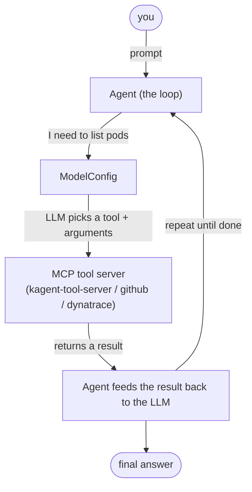

# 1. kagent in 5 minutes

Before you build anything, here's the mental model for **kagent** — the piece
that turns "an LLM calling some tools" into **agents you can deploy, secure,
observe, and evaluate like any other Kubernetes workload**.

## Why run agents on Kubernetes at all?

An AI agent is a loop: a model reads a goal, decides which **tool** to call,
reads the result, and repeats until it's done. Run that loop from a laptop script
and you get no isolation, no shared credentials story, no telemetry, and no way
for one agent to hand work to another. kagent moves the loop onto Kubernetes, so
an agent becomes a first-class, declarative object — reconciled by a controller,
scheduled onto nodes, and wired into the same observability and security tooling
as the rest of your platform.

!!! quote "The one-line definition"
    **kagent is an agentic runtime for Kubernetes.** You describe agents, models,
    and tools as custom resources; a controller runs them, exposes them over a
    standard agent-to-agent (A2A) API, and keeps them reconciled.

## The four objects you'll meet

kagent ships a handful of CRDs. In this workshop you only need four of them:

| CRD | What it is | Where you'll see it |
|-----|------------|---------------------|
| `ModelConfig` | Which LLM an agent talks to (provider, model, endpoint, secret). | [`agents/mcp/00-modelconfig.yaml`](https://github.com/dynatrace-wwse/workshop-dynatrace-ai-agents/blob/main/agents/mcp/00-modelconfig.yaml) — the shared `workshop-llm` (DeepSeek). |
| `Agent` | A deployed agent: a system prompt + a `ModelConfig` + the tools it may call. | the SRE agent and the six BMAD agents (module 4). |
| `MCPServer` | A tool server that runs **inside** the cluster (stdio or HTTP). | GitHub MCP (module 4). |
| `RemoteMCPServer` | A reference to a tool server reached over the network, whose tools kagent discovers. | the built-in `kagent-tool-server`, Dynatrace MCP (module 4). |

Everything else — the controller, the UI, the bundled database, and `kmcp` (the
MCP plumbing) — runs for you once the platform is installed (module 3).

## How a tool call actually happens

Two acronyms matter:

- **MCP (Model Context Protocol)** is the open standard for *how an agent
  discovers and calls tools*. kagent speaks it, so any MCP server — GitHub's,
  Dynatrace's, or your own — plugs in the same way.
- **A2A (Agent-to-Agent)** is the protocol *agents* use to call *each other*.
  The BMAD orchestrator delegates to the analyst, PM, architect, developer, and
  QA agents over A2A; that's how a "crew" works when there is no Team CRD.

## Why it fits this workshop's theme

The whole lab is about **cost-efficient** agents. Because kagent makes each tool
call, model call, and agent hand-off a real span emitted over OpenTelemetry (we
wire this in module 3), you can *see* where tokens and latency actually go — and
in module 9 you use that evidence to cut the waste. No runtime, no visibility;
no visibility, no optimization.

!!! tip "You don't configure kagent by hand here"
    Every object above is applied for you by the functions in modules 3–4. This
    page is just so the YAML you're about to read makes sense. If you want the
    full CRD reference, see the [kagent docs](https://kagent.dev).

<!-- LAB_QUESTION
type: multiple-choice
question: "Which kagent object decides which LLM an agent talks to?"
options:
  - "Agent"
  - "ModelConfig"
  - "MCPServer"
  - "RemoteMCPServer"
correct: 1
explanation: "ModelConfig holds provider, model, endpoint and secret. Every workshop agent references the same one: workshop-llm."
-->

<!-- LAB_QUESTION
type: multiple-choice
question: "What is the difference between MCP and A2A?"
options:
  - "MCP is how an agent calls tools; A2A is how agents call each other"
  - "MCP is for Kubernetes, A2A is for Dynatrace"
  - "They are two names for the same protocol"
  - "A2A carries telemetry, MCP carries prompts"
correct: 0
explanation: "MCP standardises tool discovery and calls. A2A is the agent-to-agent protocol the BMAD orchestrator uses to delegate."
-->

<!-- LAB_NO_SOLUTION: concept page — nothing in the environment changes -->

- [2. Setup :octicons-arrow-right-24:](2-setup.md)

