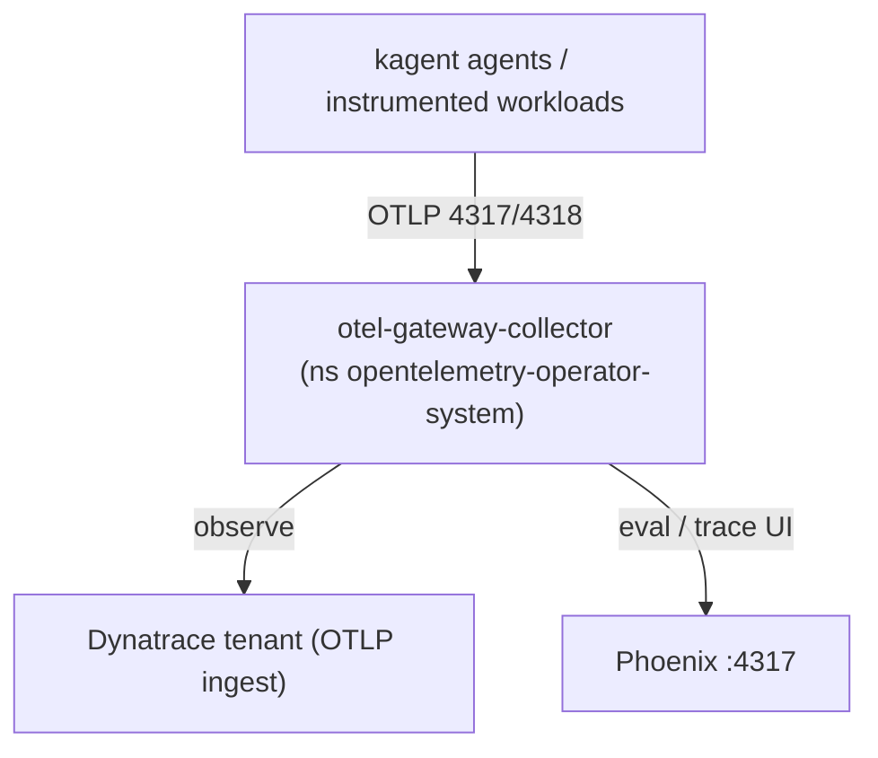

# 3. Platform install

With the cluster running (module 2), meet the observability + agent platform.
The manifests live under [`cluster/`](https://github.com/dynatrace-wwse/workshop-dynatrace-ai-agents/tree/main/cluster);
the installers are functions in `.devcontainer/util/my_functions.sh`.

!!! info "What gets installed"
    Dynatrace Operator (Kubernetes monitoring), OpenTelemetry Operator + a gateway
    collector, kagent (clean base — no agents yet), Tetragon (eBPF security),
    an Agent Sandbox isolation baseline, and Phoenix (LLM eval/trace UI).

## 1. What is already installed

Your environment's post-create step ran `installPlatform`, which installs, in
order:

| Component | How | Namespace |
|---|---|---|
| Dynatrace Operator + DynaKube (Kubernetes monitoring, ActiveGate only) | framework `dynatraceDeployOperator` + `deployDynatrace k8s-only` | `dynatrace` |
| OpenTelemetry Operator + gateway collector | Helm + [`cluster/otel/collector-gateway.yaml`](https://github.com/dynatrace-wwse/workshop-dynatrace-ai-agents/blob/main/cluster/otel/collector-gateway.yaml) | `opentelemetry-operator-system` |
| Phoenix | [`cluster/phoenix/phoenix.yaml`](https://github.com/dynatrace-wwse/workshop-dynatrace-ai-agents/blob/main/cluster/phoenix/phoenix.yaml), published as app `phoenix` | `phoenix` |
| kagent (clean base — no agents yet) | OCI Helm chart, published as app `kagent` | `kagent` |
| Tetragon | Helm | `tetragon` |
| Agent Sandbox baseline | [`cluster/agent-sandbox/isolation.yaml`](https://github.com/dynatrace-wwse/workshop-dynatrace-ai-agents/blob/main/cluster/agent-sandbox/isolation.yaml) | `agent-sandbox` |
| LLM backend | DeepSeek secret, or Ollama when no key is set | `kagent` / `ollama` |

Every piece is idempotent, so you can re-run any of them — or the whole thing:

```bash
installPlatform        # everything above
installOtelGateway     # or one component at a time
```

## 2. Verify the platform

```bash
kubectl get pods -A                                   # everything Running
kubectl get dynakube -n dynatrace                     # Dynatrace k8s monitoring
kubectl get otelcol -n opentelemetry-operator-system  # gateway collector
kubectl -n kagent get pods                            # kagent controller / ui / kmcp
kubectl -n phoenix get pods                           # Phoenix
listApps                                              # kagent + phoenix URLs
```

<!-- LAB_QUESTION
type: shell-verification
question: "Verify the agent platform is running"
buttonText: "Check platform"
command: "source .devcontainer/util/source_framework.sh >/dev/null 2>&1 && checkPlatform"
expect:
  operator: exit-zero
hint: "Something is not Ready yet. Run `installPlatform` in the Terminal (it is safe to re-run) and check again."
explanation: "OTel operator, gateway collector, kagent controller + UI and Phoenix are all Ready, and the agent-sandbox namespace exists."
-->

<!-- LAB_QUESTION
type: shell-verification
question: "Verify Dynatrace is monitoring your cluster"
buttonText: "Check DynaKube"
command: "source .devcontainer/util/source_framework.sh >/dev/null 2>&1 && checkDynatrace"
expect:
  operator: exit-zero
hint: "The DynaKube is not Running yet — the ActiveGate can take 2–3 minutes. Check `kubectl -n dynatrace get pods`, or run `installDynatrace`."
explanation: "The DynaKube is Running: the ActiveGate reports your cluster's topology, events and metrics to Dynatrace."
-->

<!-- LAB_SOLUTION
commands:
  - installPlatform
verify:
  - source .devcontainer/util/source_framework.sh >/dev/null 2>&1 && checkPlatform
  - source .devcontainer/util/source_framework.sh >/dev/null 2>&1 && checkDynatrace
reveal: |
  `installPlatform` runs the seven installers in order: Dynatrace (framework
  operator + a Kubernetes-monitoring DynaKube named after your session), the
  OpenTelemetry Operator and gateway collector, Phoenix, kagent, Tetragon, the
  Agent Sandbox baseline and the LLM backend. Each one is `helm upgrade --install`
  or `kubectl apply`, so re-running it reconciles rather than duplicates.
-->

## How telemetry flows



The gateway normalises OpenInference/Traceloop LLM attributes to OpenTelemetry
`gen_ai.*` semconv so Dynatrace and Phoenix agree on names. There are **no agents
yet** — kagent is a clean base; module 4 deploys the SRE agent and the
BMAD crew, at which point spans start landing in both backends.

!!! note "BindPlane"
    BindPlane (OTel collector management) is **illustrated, not installed** — see
    the [walkthrough](https://github.com/dynatrace-wwse/workshop-dynatrace-ai-agents/blob/main/cluster/otel/bindplane-illustrated.md).

<!-- LAB_QUESTION
type: multiple-choice
question: "An agent's LLM call produces a span. Where does that span go?"
options:
  - "Straight from the agent to Dynatrace, bypassing everything else"
  - "To the OTel gateway collector, which fans it out to Dynatrace and to Phoenix"
  - "Only to Phoenix — Dynatrace sees Kubernetes metrics, not agent spans"
  - "To the Dynatrace ActiveGate, which forwards it to Phoenix"
correct: 1
explanation: "kagent exports OTLP to otel-gateway-collector. The gateway normalises LLM attributes to gen_ai.* and exports the same span to both backends."
-->

## Troubleshooting

- **Tetragon not Ready** — eBPF/BTF on the container node's kernel; see
  [`cluster/tetragon/README.md`](https://github.com/dynatrace-wwse/workshop-dynatrace-ai-agents/blob/main/cluster/tetragon/README.md).
- **OTel operator hangs** — it must use its self-signed webhook cert
  (`autoGenerateCert`), already set in `otel/operator-values.yaml`.
- **No data in Dynatrace** — check `kubectl -n opentelemetry-operator-system logs deploy/otel-gateway-collector`;
  the ingest token needs `openTelemetryTrace.ingest`, `metrics.ingest`, `logs.ingest`.

<div class="grid cards" markdown>
- [4. Agents & MCP wiring :octicons-arrow-right-24:](4-agents-mcp.md)
</div>
