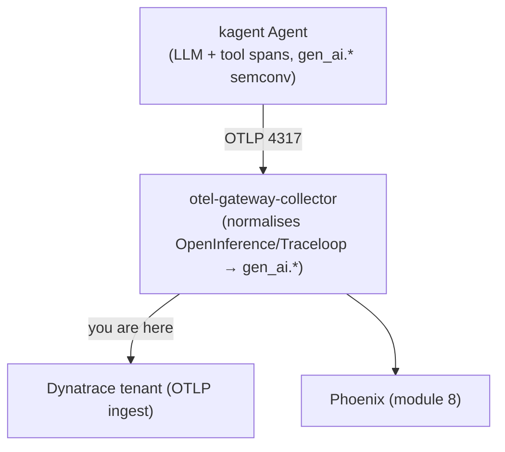
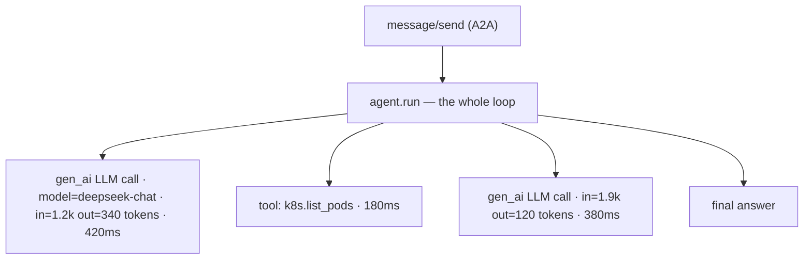

# 6. Observe with Dynatrace AI Observability

You now have agents running (module 4) inside a secured sandbox (module 5).
But are they fast? Reliable? **How much are they costing you per run?** This
module uses **Dynatrace AI Observability** to answer that — turning the spans
your agents already emit into cost, token, latency, and quality signals.

!!! info "Nothing to install here"
    The pipeline was wired in module 3: kagent's `otel.tracing` sends every LLM
    call, tool call, and agent hop as an OTLP span to the gateway collector,
    which forwards to **both** Dynatrace and Phoenix. This module is about
    *reading* that data in Dynatrace.

## How agent telemetry reaches Dynatrace



The gateway normalises OpenInference/Traceloop LLM attributes onto the
OpenTelemetry `gen_ai.*` semantic conventions, so Dynatrace sees consistent
`gen_ai.request.model`, `gen_ai.usage.input_tokens`,
`gen_ai.usage.output_tokens`, and token/latency fields regardless of which
instrumentation a tool used.

!!! tip "Production tip — use the `genainormalizer` processor"
    The workshop does this with a few OTTL `set()` statements because it runs the
    lighter `opentelemetry-collector-k8s` image. Outside the workshop, prefer the
    purpose-built
    [`genainormalizer` processor](https://explorer.opentelemetry.io/collector/components/contrib/genainormalizerprocessor?type=processor&version=0.155.0):
    it ships maintained OpenInference/OpenLLMetry (Traceloop) mappings against
    GenAI semconv v1.40.0. It is a **contrib** component (Alpha for traces), so it
    requires the `opentelemetry-collector-contrib` image or a custom OCB build.

## 1. Generate some traffic

Observability needs something to observe. Send a few prompts so there are runs to
inspect — either way from module 4 works (kagent UI → **sre-agent**, or `askSreAgent`
below):

```bash
generateAgentTraffic      # two diagnostic prompts to the SRE agent
askSreAgent "List pods in all namespaces and summarise anything not Running."
```

Run a BMAD workflow too if you have a `GH_PAT` and want a longer, multi-hop
trace to look at.

Every one of those runs is already in **Phoenix** — the same gateway feeds both
backends, so this check needs no tenant:

<!-- LAB_QUESTION
type: shell-verification
question: "Verify your agent runs reached Phoenix"
buttonText: "Check Phoenix"
command: "source .devcontainer/util/source_framework.sh >/dev/null 2>&1 && checkPhoenixHasTraces"
expect:
  operator: exit-zero
hint: "Run `generateAgentTraffic` first; the gateway batches spans for ~5 s and Phoenix indexes them shortly after."
explanation: "Phoenix holds your agents' traces — the gateway is exporting OTLP."
-->

<!-- LAB_SOLUTION
commands:
  - generateAgentTraffic
  - sleep 30
verify:
  - source .devcontainer/util/source_framework.sh >/dev/null 2>&1 && checkPhoenixHasTraces
reveal: |
  `generateAgentTraffic` sends two prompts to the SRE agent over A2A. kagent's
  `otel.tracing` exports every LLM call, tool call and agent hop to the gateway,
  which forwards them to Dynatrace and Phoenix.
-->

Now the same spans in **your** tenant. The gateway stamps every span with your
cluster's name, which ends with your session id — so this counts only yours:

```dql
fetch spans, from:now()-2h
| filter endsWith(k8s.cluster.name, "{{DT_SESSION_ID}}")
| filter isNotNull(gen_ai.request.model) or isNotNull(gen_ai.operation.name)
| summarize spans = count(), inputTokens = sum(gen_ai.usage.input_tokens), outputTokens = sum(gen_ai.usage.output_tokens), by:{ gen_ai.request.model }
```

<!-- LAB_QUESTION
type: dql-verification
question: "Verify your agents' gen_ai spans are in Dynatrace"
buttonText: "Run DQL"
dql: "fetch spans, from:now()-2h | filter endsWith(k8s.cluster.name, \"{{DT_SESSION_ID}}\") | filter isNotNull(gen_ai.request.model) or isNotNull(gen_ai.operation.name) | summarize spans = count()"
expect:
  operator: gt
  field: spans
  value: 0
hint: "Spans take 1–2 minutes to arrive. Send a prompt with `askSreAgent`, wait, and run the check again."
explanation: "Your agents' LLM and tool spans are in Grail, scoped to your cluster — the raw material of AI Observability."
-->

## 2. Open AI Observability in Dynatrace

In your Dynatrace tenant, open
**AI Observability** (apps menu → *Observe & Explore* → **AI & LLM
Observability**, or search the app launcher for "AI Observability").

!!! note "What you should see"
    A list of AI/LLM **services** and **model endpoints**. Because every agent
    shares the `workshop-llm` ModelConfig (DeepSeek), you'll see the DeepSeek
    endpoint with call volume, token usage, latency distribution, error rate, and
    an **estimated cost** per call and in aggregate.

## 3. The four questions to ask every agent run

Dynatrace AI Observability is organised around the metrics that drive the
workshop's cost-efficiency theme. For each agent, look at:

| Question | Where to look | What "good" looks like |
|----------|---------------|------------------------|
| **How much does a run cost?** | Token usage × model price → estimated cost per request / per service. | Stable, proportional to task size — no silent blow-ups. |
| **Where does the latency go?** | Span waterfall: model time vs tool time vs agent-to-agent hops. | Model/tool time dominates; little idle gap. |
| **Is it reliable?** | Error rate + failure spans (tool errors, model timeouts, A2A failures). | Low, with clear error messages when it does fail. |
| **Is it efficient?** | Tokens per task, number of tool calls per task, retries. | No redundant tool calls, no runaway token growth. |

## 4. Follow a single trace end to end

Click into one agent request. The distributed trace shows the full loop:



Each `gen_ai` span carries the model, the input/output token counts, and the
latency — so you can see **exactly which step** spent the tokens. For a BMAD run,
you additionally see the orchestrator's A2A hops to the analyst → PM → architect
→ developer → QA agents as nested spans.

!!! tip "Build a cost view with DQL"
    The Dynatrace MCP server (module 4) lets the SRE agent query this itself,
    but you can also open **Notebooks** and run DQL against the spans, e.g. sum
    `gen_ai.usage.output_tokens` grouped by agent to rank your most expensive
    agents. That ranking is the raw material for module 9 (Optimize).

## 5. Correlate with the rest of the cluster

Because module 3 also installed the Dynatrace Operator in Kubernetes-monitoring
mode, the agent traces sit **next to** your cluster topology. Under **Kubernetes**
you can line up an expensive agent run against pod CPU/memory, restarts, and
node pressure — so "slow agent" vs "starved pod" is one click apart.

## What you achieved (acceptance)

- Every agent run appears in Dynatrace AI Observability with **cost, tokens,
  latency, and error** signals.
- You can open a single trace and attribute spend to a specific model or tool
  call, and correlate it with Kubernetes health.

<!-- LAB_QUESTION
type: multiple-choice
question: "An agent shows a 38 : 1 input-to-output token ratio. What does that tell you first?"
options:
  - "The model is too small and should be replaced"
  - "The agent re-sends a large context (prompt, tool schemas, history) on every call"
  - "The answers are too long"
  - "Nothing — ratios above 10 : 1 are normal and free"
correct: 1
explanation: "Input dominates: every call re-reads a big context. That points at tool schemas, the system prompt and multi-hop loops — the cuts in module 9."
-->

<div class="grid cards" markdown>
- [7. Diagnose a broken cluster :octicons-arrow-right-24:](7-diagnose.md)
</div>
