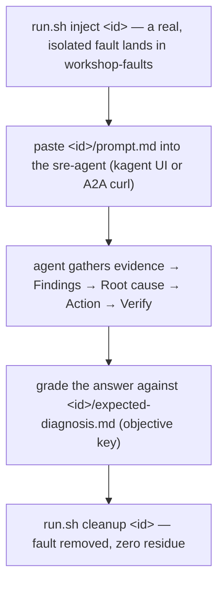

# 7. Diagnose a broken cluster with kagent

You have agents running (module 4), secured (module 5), and their every run
flowing into Dynatrace as cost, token, latency, and quality signals (module 6).
But so far nothing has *broken*. The `sre-agent` has only answered toy prompts
("list the pods"). This module is the payoff: **inject a real Kubernetes
failure, ask the agent, and watch it reach the root cause** — then grade its
answer against a ground-truth key.

!!! info "Nothing new to install"
    This module reuses the **module-4 `sre-agent`** exactly as-is. It already
    has the right surface — read/investigate tools (`k8s_get_resources`,
    `k8s_describe_resource`, `k8s_get_pod_logs`, `k8s_get_events`), a minimal
    non-destructive operate set (scale/patch/rollout), and the full Dynatrace
    MCP — and a system prompt that *is* a "Findings → Root cause → Action →
    Verify" SRE loop. Nothing here grants the agent new destructive power; there
    is no `k8s_delete_resource`.

## Why break things

You can't convince yourself an AI agent can do first-line SRE triage by watching
it on a healthy cluster. You validate it the way a real on-call does: break
something you understand, ask the agent, and check its answer against what you
*know* is wrong. That is the diagnosis loop the
[`scenarios/`](https://github.com/dynatrace-wwse/workshop-dynatrace-ai-agents/tree/main/scenarios)
directory encodes:



Each scenario ships three files: `manifests.yaml` (the breakage), `prompt.md`
(the exact prompt to paste — it never names the root cause), and
`expected-diagnosis.md` (the objective answer key). The infra scenarios sit on
**distinct evidence channels** on purpose — logs vs. events vs.
terminated-reason — so even a small model (DeepSeek-V3) can be graded without
ambiguity.

## Prereqs

- **SRE agent deployed** — module 4 (`sre-agent` in the `kagent` namespace).
  This is the only hard requirement for scenarios 01–03.
- **(Scenario 12 only) Observe pipeline live** — module 6, plus the opt-in
  `opentelemetry-demo-light` app. Scenario 12 is the Dynatrace-correlation
  scenario and is **skippable** (see the callout below).

!!! warning "Scenario 12 has an extra resource footprint — skippable on the minimum tier"
    Scenarios **01–03 are self-contained** and cost almost nothing: each spins up
    one throwaway Deployment. **Scenario 12 additionally needs the opt-in
    `opentelemetry-demo-light` astronomy-shop app deployed** (and Dynatrace, to
    show the correlation). On a **minimum 4-core / 16 GB Codespace, skip 12** and
    run 01–03 — you still get the full infra-diagnosis payoff. Only enable 12 if
    you have headroom. The platform stack is already installed (module 3), so
    this is a **single Helm install** of just the demo app:
    ```bash
    deployOtelDemoLight
    ```
    If `astroshop-lite`
    is not deployed, `run.sh inject 12` fails fast and prints this exact Helm
    command — nothing breaks, you're just told cleanly why 12 is unavailable.

List what's available any time:

```bash
bash scenarios/run.sh list     # id, title, and an [app-dep: astroshop-lite] tag on #12
```

## Walkthrough — scenario 01, CrashLoopBackOff

The rest of this page walks the canonical "hello world" of k8s diagnosis end to
end. Scenarios 02 (ImagePullBackOff) and 03 (OOMKilled) follow the **exact same
four steps** — just swap the id and paste that scenario's `prompt.md`.

### 1. Inject the fault

```bash
injectScenario 01      # = bash scenarios/run.sh inject 01-crashloopbackoff
```

`run.sh` creates the dedicated `workshop-faults` namespace and applies the
fault's `manifests.yaml`. A fail-closed allowlist rejects any manifest that
references `kagent`, `dynatrace`, the module-5 `agent-sandbox`, or any platform
namespace **before anything is applied** — the blast radius is one throwaway
namespace. Watch it break:

```bash
kubectl get pods -n workshop-faults
```

```
NAME                              READY   STATUS             RESTARTS   AGE
billing-worker-5c9f8d7b6c-ab12x   0/1     CrashLoopBackOff   4          90s
```

<!-- LAB_QUESTION
type: shell-verification
question: "Verify the fault is live in workshop-faults"
buttonText: "Check fault"
command: "source .devcontainer/util/source_framework.sh >/dev/null 2>&1 && checkScenarioInjected"
expect:
  operator: exit-zero
hint: "Run `injectScenario 01` and give the pod ~30 s to crash a few times."
explanation: "billing-worker is crash-looping — a real fault the agent has never been told about."
-->

### 2. Ask the agent

Open each scenario's `prompt.md` and paste the prompt **exactly** — it describes
the *symptom* and asks for evidence, but it never tells the agent the root cause.
For scenario 01 (`scenarios/01-crashloopbackoff/prompt.md`):

**Terminal**

```bash
diagnoseScenario 01      # sends scenarios/01-crashloopbackoff/prompt.md over A2A
```

**kagent UI**

Open the **kagent** app (`listApps`), pick **sre-agent**, and paste:

> A pod in the `workshop-faults` namespace keeps restarting. Investigate what
> is wrong with the workload there, find the root cause, and tell me the exact
> evidence (status, events, and logs) that supports it.

**A2A (curl)**

```bash
kubectl run a2a --rm -i --restart=Never --image=curlimages/curl:8.10.1 -n kagent \
  --command -- curl -s -m 300 -X POST -H 'Content-Type: application/json' \
  --data '{"jsonrpc":"2.0","id":"1","method":"message/send","params":{"message":{"role":"user","messageId":"m1","kind":"message","parts":[{"kind":"text","text":"A pod in the workshop-faults namespace keeps restarting. Investigate the workload there, find the root cause, and cite the exact status, events, and log lines that support it."}]}}}' \
  http://kagent-controller.kagent:8083/api/a2a/kagent/sre-agent
```

The agent will walk its SRE loop live: list the pods, describe the failing one,
pull its events and logs, and converge on a conclusion.

<!-- LAB_QUESTION
type: shell-verification
question: "Verify the SRE agent returned a diagnosis"
buttonText: "Check answer"
command: "source .devcontainer/util/source_framework.sh >/dev/null 2>&1 && checkAgentAnswered sre-agent"
expect:
  operator: exit-zero
hint: "Run `diagnoseScenario 01` in the Terminal (the kagent UI conversation is not recorded for this check). It can take a few minutes."
explanation: "The agent investigated and answered. Now grade it against the key."
-->

### 3. Grade it

Open the scenario's `expected-diagnosis.md` — the **objective answer key** — and
check the agent's conclusion against it. Scenario 01's key wants the agent to:

- report `billing-worker` in **CrashLoopBackOff**;
- cite the non-zero **exit code (1)** from `lastState.terminated`;
- quote the **`Back-off restarting failed container`** event;
- quote the **fatal log line** (`BILLING_DB_URL is not set`);
- conclude the **start command fails on launch**.

The key also lists a `pass_threshold` (how many signals must be cited) and a
**Must NOT claim** section that catches small-model confabulation — e.g. for the
crash-loop, claiming an `ImagePullBackOff` (scenario 02) or `OOMKilled`
(scenario 03) is an unambiguous **fail**, because those are *different* evidence
channels. That cross-channel discipline is why the diagnosis is graded
objectively.

The same key is machine-readable (`evals/ground-truth/`), so you can grade the
agent's answer you just got with one command:

```bash
gradeLiveDiagnosis 01
```

It prints the signals cited, whether the root cause was named, and PASS or FAIL.
A FAIL is a result, not an error — on the small in-cluster model it is common,
and it is exactly what modules 8 and 9 are about.

<!-- LAB_QUESTION
type: shell-verification
question: "Grade the agent's diagnosis against the answer key"
buttonText: "Check grading"
command: "source .devcontainer/util/source_framework.sh >/dev/null 2>&1 && checkDiagnosisGraded 01"
expect:
  operator: exit-zero
hint: "Run `gradeLiveDiagnosis 01` in the Terminal after `diagnoseScenario 01`."
explanation: "The diagnosis was graded objectively: PASS or FAIL, with the signals it cited."
-->

<!-- LAB_QUESTION
type: multiple-choice
question: "For the CrashLoopBackOff scenario the agent concludes the pod is OOMKilled. How is that graded?"
options:
  - "Partial credit — it found a broken pod"
  - "FAIL — OOMKilled is a different evidence channel and is listed under Must NOT claim"
  - "PASS if it also cites the restart count"
  - "It depends on which LLM the agent used"
correct: 1
explanation: "Each scenario sits on a distinct evidence channel (logs / events / terminated reason). Claiming another scenario's channel is an unambiguous fail — that is what makes the grade objective."
-->

!!! tip "Each infra scenario exercises a different sense"
    **01 reads logs**, **02 reads events** (`Failed to pull image` — no logs
    exist yet, so a logs-only agent is stuck), and **03 reads
    `lastState.terminated.reason: OOMKilled`** (it looks like a crash loop until
    you check *why* it was killed). Running all three proves the agent reads the
    *right* signal for each failure class, not just one trick.

### 4. (Optional) Remediate & verify

Ask the agent for the **minimal safe fix**, then watch it act within its
non-destructive operate set:

> You found the root cause. Propose and apply the minimal, safe fix, then verify
> the pod reaches a healthy state.

For scenario 01 that means supplying the missing configuration (or correcting the
start command) and rolling out the Deployment — `k8s_patch_resource` +
`k8s_rollout`, never a delete. Re-run `kubectl get pods -n workshop-faults` and
confirm the pod goes `Running`. The agent can only patch/apply/scale/rollout, so
this stays safe by construction.

### 5. Cleanup

```bash
cleanupScenario 01     # deletes the workshop-faults ns — zero residue
```

Cleanup is one command and idempotent. For infra scenarios it deletes exactly the
`workshop-faults` namespace; it never touches `kagent`, `dynatrace`, the demo
app, or any platform namespace.

<!-- LAB_QUESTION
type: shell-verification
question: "Verify the fault left no residue"
buttonText: "Check cleanup"
command: "source .devcontainer/util/source_framework.sh >/dev/null 2>&1 && checkScenarioClean"
expect:
  operator: exit-zero
hint: "Run `cleanupScenario 01`; namespace deletion takes a few seconds."
explanation: "workshop-faults is gone; the platform was never touched."
-->

<!-- LAB_SOLUTION
commands:
  - injectScenario 01
  - waitForScenario
  - diagnoseScenario 01
  - gradeLiveDiagnosis 01 || true
  - cleanupScenario 01
  - for i in $(seq 1 24); do kubectl get ns workshop-faults >/dev/null 2>&1 || break; sleep 5; done
verify:
  - source .devcontainer/util/source_framework.sh >/dev/null 2>&1 && checkScenarioInjected
  - source .devcontainer/util/source_framework.sh >/dev/null 2>&1 && checkAgentAnswered sre-agent
  - source .devcontainer/util/source_framework.sh >/dev/null 2>&1 && checkDiagnosisGraded 01
  - source .devcontainer/util/source_framework.sh >/dev/null 2>&1 && checkScenarioClean
reveal: |
  The loop is inject → ask → grade → clean up. `diagnoseScenario 01` sends the
  scenario's prompt (symptom only, never the cause) to the SRE agent;
  `gradeLiveDiagnosis 01` scores the answer against
  `evals/ground-truth/01-crashloopbackoff.json`. The grade itself may be PASS or
  FAIL depending on the model — the step only requires that it was graded.
-->

## The Dynatrace money shot — scenario 12 (optional)

Scenarios 01–03 are diagnosable from **cluster state alone**. Scenario 12 is the
one that shows off the workshop's real differentiator: the agent **correlating
Kubernetes with Dynatrace**. A faulty `product-catalog` backend joins the
`product-catalog` Service's endpoints, so a *fraction* of the astronomy shop's
product requests are load-balanced to it and fail — **intermittent 5xx**, not a
clean outage.

```bash
bash scenarios/run.sh inject 12      # adds a faulty product-catalog backend (via inject.sh)
```

Paste `scenarios/12-intermittent-5xx/prompt.md` and point the agent at
**Dynatrace**:

> Users of the astronomy shop (namespace `astroshop-lite`) are seeing intermittent
> errors when they browse products — some requests work, some fail. Use
> Dynatrace to find the open problem and its Davis root cause, correlate it with
> the cluster state, and tell me which service is actually at fault and why.

A correct answer cites an **open Dynatrace problem** on the product path, names
**`product-catalog`** as the **Davis root-cause entity** (not the frontend that
merely surfaces it), notes the failures are **intermittent** (a partial error
rate), and corroborates with k8s that the `product-catalog` Service has an
**extra, unhealthy backend** in rotation. Grade against its
`expected-diagnosis.md` (`pass_threshold: 4`). Clean up with:

```bash
bash scenarios/run.sh cleanup 12     # removes only the faulty backend — never the healthy demo
```

## So what — these runs feed the rest of the workshop

This module isn't a detour; it's the fuel for everything after it.

!!! success "Every diagnosis run you just made is reusable evidence"
    - **Eval fixtures for [8 — Evaluate](8-evaluate.md):** each
      `expected-diagnosis.md` doubles as **ground truth** — the same Required
      signals / Must NOT claim keys become the scoring rubric for Phoenix and
      dt-evals. You now have real, labelled traces to grade, not toy prompts.
    - **Cost data for [9 — Optimize](9-optimize.md):** every run emitted
      `gen_ai.*` spans with token, cost, and latency. A diagnosis is a realistic,
      multi-tool task — exactly the kind of run whose token spend module 9
      teaches you to cut without losing accuracy.

## What you achieved (acceptance)

- You injected a real, isolated Kubernetes fault and the **module-4 `sre-agent`
  reached the correct root cause**, citing the exact signals.
- You **graded** its answer objectively against `expected-diagnosis.md`, and
  (optionally) watched it remediate within its non-destructive tool set.
- Cleanup left **zero residue** — the platform and module-5 isolation boundary
  were never touched.

Next: **[8 — Evaluate (Phoenix + dt-evals)](8-evaluate.md)** — you diagnosed
and graded by hand here; now turn those answer keys into an automated eval suite.
