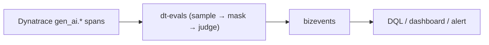

# 8. Evaluate (Phoenix + dt-evals)

Observability (module 6) tells you *what the agent did* and *what it cost*. It
does **not** tell you whether the answer was correct, grounded, or useful. That's
**evaluation** — scoring agent outputs against expectations — and it's the step
most teams skip, which is why their agents quietly regress.

Both tools here evaluate the **same `gen_ai.*` spans** the OTel gateway already
produces (module 4/6) — you don't re-run the agents to grade them, you grade
the traces they already emitted:

- **Phoenix (Arize)** — interactive trace + eval UI, already running from
  module 3. Great for *exploratory* LLM-as-a-judge over live traces.
- **dt-evals** — [`dynatrace-oss/dt-evals`](https://github.com/dynatrace-oss/dt-evals),
  the **primary** path: a config-driven CLI that pulls `gen_ai.*` spans from
  Dynatrace, scores them with a judge, and writes the results back as bizevents
  next to the rest of your telemetry.

Everything for this module lives under
[`evals/`](https://github.com/dynatrace-wwse/workshop-dynatrace-ai-agents/tree/main/evals).
Both paths reuse the cost-efficient workshop judge — **DeepSeek** (`deepseek-chat`),
the same model that powers the agents — set once in `evals/.env`
(copy from `evals/.env.example`).

!!! warning "Generate traffic first"
    Evals score real traces. Drive the SRE agent or a BMAD task (module 4)
    **before** running either path, so there are spans to grade.

---

## Part A — Phoenix: explore and judge live traces

Open the **phoenix** app (`listApps` prints its URL).

Every agent run shows up as an LLM trace: prompt, response, tool spans, token
counts. Click a span to see its `gen_ai.*` attributes.

### Run an evaluation (LLM-as-a-judge)

!!! note "Needs a judge key"
    Parts A and B call an LLM judge (DeepSeek by default, `OPENAI_API_KEY` in
    `evals/.env`). Without a key, read them and run **Part C**, which grades
    deterministically and needs nothing.

The repo ships a small, version-pinned eval script that builds two judge
classifiers — **hallucination** (is the answer grounded in its context?) and
**relevance** (does it answer the question?):

```bash
cd evals && uv sync
# Bundled sample dataset — no cluster/traffic needed (just a judge key):
uv run python phoenix/run_phoenix_eval.py
# Live spans pulled from Phoenix, scores logged back onto the traces:
uv run python phoenix/run_phoenix_eval.py --from-phoenix
```

It prints a per-metric summary, writes `phoenix/out/phoenix_eval_results.csv`,
and (with `--from-phoenix`) annotates the originating spans so the labels show up
on the traces in the UI. Details: [`evals/phoenix/README.md`](https://github.com/dynatrace-wwse/workshop-dynatrace-ai-agents/blob/main/evals/phoenix/README.md).

This is *exploratory*: fast, visual, good for discovering failure modes. For a
gate you can run in CI, use dt-evals.

---

## Part B — dt-evals: trace-sourced evals in Dynatrace

[`dt-evals`](https://github.com/dynatrace-oss/dt-evals) is the **primary eval
path**. It samples `gen_ai.*` spans from your Dynatrace environment, masks PII,
scores each with an LLM judge, and writes `gen_ai.evaluation.result` **bizevents**
back — so a low score is one click from the trace, prompt, and tool calls that
caused it.



### 1. Credentials

dt-evals needs (put these in `evals/.env`). You created these during onboarding —
see
[`.devcontainer/SECRETS.md`](https://github.com/dynatrace-wwse/workshop-dynatrace-ai-agents/blob/main/.devcontainer/SECRETS.md) (see also [TODO-HENRIK §8](https://github.com/dynatrace-wwse/workshop-dynatrace-ai-agents/blob/main/TODO-HENRIK.md))
for exact scopes and where each is generated:

| Var | What |
|-----|------|
| `DYNATRACE_API_TOKEN` | a **dedicated** `dt0c01` token with `storage:spans:read` + `storage:events:write` (not the module 3 OTLP token) |
| `DT_ENVIRONMENT_URL` | your `…apps.dynatrace.com` URL (derived from `DT_TENANT_URL` if unset) |
| `OPENAI_API_KEY` | judge key — a DeepSeek key works |
| `DT_EVAL_SERVICE` | the agent's `service.name` — **discover it, don't guess** |

Discover the service with DQL (Dynatrace Notebook):

```dql
fetch spans, from: now() - 2h
| filter isNotNull(gen_ai.operation.name) or isNotNull(gen_ai.request.model)
| summarize span_count = count(), by: { service.name }
| sort span_count desc
```

### 2. Run it

The CLI runs via `npx` (Node ≥ 22); the wrapper renders the config
([`evals/dt-evals/workshop-agents.dt-eval.yaml`](https://github.com/dynatrace-wwse/workshop-dynatrace-ai-agents/blob/main/evals/dt-evals/workshop-agents.dt-eval.yaml))
with your env values and runs `validate` + `run`:

```bash
cd evals/dt-evals
./run-dt-eval.sh
```

The config enables agent-relevant metrics (relevance, faithfulness,
hallucination, coherence, toxicity, prompt-injection) and sets alert thresholds
that make the run **exit non-zero** on a breach — a ready-made CI gate.

### 3. Read the scores

```dql
fetch bizevents
| filter event.type == "gen_ai.evaluation.result"
| summarize avg(toDouble(gen_ai.evaluation.score.value)), by: { gen_ai.evaluation.name }
```

!!! tip "Shared vs per-attendee tenant"
    dt-evals reads spans **and** writes bizevents scoped by `service.name`. The
    workshop default is a **per-attendee Dynatrace tenant** (a free trial is
    enough) so nobody grades anyone else's traffic; a shared-tenant fallback with
    per-attendee `service.name` suffixes is documented in
    [`evals/dt-evals/README.md`](https://github.com/dynatrace-wwse/workshop-dynatrace-ai-agents/blob/main/evals/dt-evals/README.md#tenant-model-74).

---

## Part C — grade a *diagnosis* against the answer key

Parts A/B judge generic quality (grounded? relevant? toxic?). The **diagnostic
module** ([7 — Diagnose](7-diagnose.md)) asks a sharper question: when the SRE
agent investigates a *real* injected fault, **did it reach the right root
cause?** Each scenario ships an objective answer key —
`scenarios/<id>/expected-diagnosis.md` — and those keys are **registered as this
module's diagnosis-grading ground truth** under
[`evals/ground-truth/`](https://github.com/dynatrace-wwse/workshop-dynatrace-ai-agents/tree/main/evals/ground-truth).

The grading check:

> Did the diagnosis cite **≥ `pass_threshold`** of the answer key's required
> signals (root cause + evidence channel), identify the root cause, and avoid the
> forbidden cross-channel claims?

Because scenarios 01–03 sit on **distinct evidence channels** (logs vs. events vs.
`OOMKilled` status), a cross-channel claim is an unambiguous fail — so this grades
objectively, even with no judge model.

### Deterministic grade (offline, no key)

```bash
runDiagnosisEval       # = cd evals && python3 phoenix/run_diagnosis_eval.py
```

The bundled dataset holds, for every scenario, one **golden** diagnosis and one
**confabulated** one (plausible, wrong channel). A grader that works must pass
the first and fail the second — four PASS, four FAIL. It prints the verdict per
diagnosis and writes `phoenix/out/diagnosis_eval_results.csv`.

<!-- LAB_QUESTION
type: shell-verification
question: "Verify the diagnosis grader separates golden from confabulated answers"
buttonText: "Check grader"
command: "source .devcontainer/util/source_framework.sh >/dev/null 2>&1 && checkDiagnosisEval"
expect:
  operator: exit-zero
hint: "Run `runDiagnosisEval` in the Terminal first."
explanation: "The grader passed the golden diagnoses and failed the confabulated ones — it can tell right from plausible."
-->

<!-- LAB_SOLUTION
commands:
  - runDiagnosisEval
verify:
  - source .devcontainer/util/source_framework.sh >/dev/null 2>&1 && checkDiagnosisEval
reveal: |
  `run_diagnosis_eval.py` loads the answer keys from `evals/ground-truth/` and
  grades each bundled diagnosis by required signals, root cause and forbidden
  cross-channel claims — pure stdlib, no model.
-->
 Add `--llm-judge` (needs a judge key) to
also run an LLM root-cause grader, or `--from-phoenix` to grade the agent's *live*
diagnosis spans and annotate them back onto the traces.

### In Dynatrace (dt-evals)

Each answer key is also rendered into a dt-evals custom evaluator. Register the
one for the scenario you ran, then grade its spans:

```bash
cd evals/dt-evals
npx -y "$DT_EVALS_PKG" evaluators add            # paste evaluators/diagnosis-<id>.md
./run-dt-eval.sh --config scenario-diagnosis.dt-eval.yaml --metric diagnosis-<id>
```

Correct diagnoses score 1, misses score 0 — a per-scenario pass/fail bizevent next
to the trace. Details:
[`evals/ground-truth/README.md`](https://github.com/dynatrace-wwse/workshop-dynatrace-ai-agents/blob/main/evals/ground-truth/README.md).

!!! tip "Closing the diagnose → evaluate → optimize loop"
    The same diagnosis runs you grade here emit the `gen_ai.*` spans whose
    token/cost/latency drive **[9 — Optimize](9-optimize.md)**. Break it
    ([7 — Diagnose](7-diagnose.md)), grade it (8), cut the waste (9).

---

## What to measure for *these* agents

| Agent | Good eval questions |
|-------|---------------------|
| **SRE agent** | Did it correctly identify the unhealthy pod? Did it call the right k8s/Dynatrace tool (not guess)? Was the diagnosis grounded in real tool output (no hallucinated pod names)? |
| **BMAD crew** | Did the workflow produce the expected artifacts (issues → branch → PR)? Did the developer agent stay within its repo scope? Did it finish within a token budget? |

<!-- LAB_QUESTION
type: multiple-choice
question: "Why does the deterministic grader not need a judge model for scenarios 01–03?"
options:
  - "Because the agent's answers are always correct"
  - "Because Phoenix grades them automatically"
  - "Because each scenario sits on a distinct evidence channel, so required signals and forbidden claims can be matched as text"
  - "Because Dynatrace Davis grades them"
correct: 2
explanation: "Logs vs. events vs. terminated reason: each fault has its own evidence, so citing the right signal — and not another scenario's — is checkable without a model."
-->

## What you achieved (acceptance)

- A Phoenix eval run produces labelled scores you can inspect in the UI (or the
  CSV) — even offline against the bundled dataset.
- A dt-evals run scores the agents' real traces and lands the results in
  Dynatrace as queryable bizevents, with a CI-friendly pass/fail gate.
- A diagnosis-grading run (Part C) scores an SRE-agent diagnosis against a
  scenario answer key — PASS/FAIL against registered ground truth, offline or in
  Dynatrace.

Next: **[9. Optimize](9-optimize.md)** — now that you can *measure* cost and
quality, go cut the waste.
