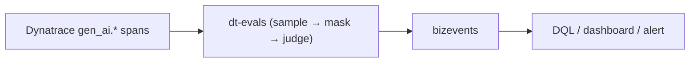

# 8. Evaluate (Phoenix + dt-evals)

Observability (module 6) tells you *what the agent did* and *what it cost*. It
does **not** tell you whether the answer was correct, grounded, or useful. That's
**evaluation** — scoring agent outputs against expectations — and it's the step
most teams skip, which is why their agents quietly regress.

This module's evals read the **same `gen_ai.*` spans** the OTel gateway already
produces (module 4/6) — you don't re-run the agents to grade them, you grade the
traces they already emitted. You **create your evaluation in Arize Phoenix**:

- **Phoenix (Arize)** — the **recommended path**. An interactive trace + eval UI,
  already running from module 3, where you **build and run an LLM-as-a-judge
  evaluation entirely in the web UI** — no code.
- **dt-evals** — a short **alternative** for teams that want eval scores to land
  **inside Dynatrace** as bizevents, next to the rest of their telemetry.
- **The diagnosis grader** (Part C) — deterministic, needs **no** model at all.

Everything for this module lives under
[`evals/`](https://github.com/dynatrace-wwse/workshop-dynatrace-ai-agents/tree/main/evals).
The judge is the workshop model — **DeepSeek** (`deepseek-chat`), the same model
that powers the agents, reached through the room-password proxy or your own
`DEEPSEEK_API_KEY` (module 2). Nothing to configure: the key is picked up from your
terminal.

!!! note "No LLM key in your session?"
    The Enablement App runs the agents on the in-cluster model and provides no
    judge key. Read Parts A and B, then run **Part C**, which grades
    deterministically and needs nothing.

!!! warning "Generate traffic first"
    Evals score real traces. Drive the SRE agent or a BMAD task (module 4)
    **before** running either path, so there are spans to grade.

---

## Part A — Phoenix: create an evaluation in the UI

Open the **phoenix** app (`listApps` prints its URL).

Every agent run shows up as an LLM trace: prompt, response, tool spans, token
counts. Click a span to see its `gen_ai.*` attributes. The OTel gateway also copies
each LLM call's prompt and completion onto the span as OpenInference
`input.value` / `output.value`, so the **Input** and **Output** are visible right in
the trace view — which is exactly what the judge reads.

!!! tip "The DeepSeek judge is already wired"
    When your session has a model key, Phoenix is preconfigured for DeepSeek: the
    key and endpoint are injected from your environment (`secret/phoenix-deepseek`)
    and `PHOENIX_ALLOWED_PROVIDERS=DEEPSEEK` restricts the model menu, so DeepSeek
    is the only — and obvious — choice wherever you pick a judge model. You never
    hand-enter a key. After a room-password rotation run `dispenseLlmKey`, then
    `installPhoenix`.

### Create and run an LLM-as-a-judge (no code)

You'll score the SRE-agent traces from your last run with a judge classifier —
**hallucination** (is the answer grounded in the tool output it was given?) or
**relevance** (does it answer the question?).

1. **Pick the traces.** Open the **Traces** table and filter to the LLM spans so
   each example carries a clean question → answer pair — paste this into the
   filter bar:

    ```text
    span_kind == 'LLM'
    ```

    Phoenix is per learner, so this is all the scoping you need. (The spans also
    carry `workshop.attendee` and your agents' names carry your `WORKSHOP_PREFIX` —
    that matters in a shared Dynatrace tenant, not here.)

2. **Capture them as a dataset.** Select the spans and use **Add to Dataset** —
   each example keeps the span's **Input** (the question) and **Output** (the
   agent's answer).
3. **Add an LLM evaluator.** Open the dataset → **Evaluators** → **Add evaluator**
   → **LLM**. Phoenix opens it in the **Playground**:
    - **Model:** DeepSeek (already keyed).
    - **Template:** the judge prompt, e.g. *"You are grading whether the ANSWER is
      grounded in the provided CONTEXT/question. Reply with a single label:
      `hallucinated` or `factual`."* (or a relevance rubric: `relevant` /
      `irrelevant`).
    - **Input mapping:** map the template's `{question}` / `{answer}` variables to
      the dataset's **input** / **output** fields.
    - **Test** it on one example, then **Save**.
4. **Run it.** From the dataset, **Run** an experiment. Phoenix calls the judge
   **server-side** over every example.

The results table gains one **label / score column per evaluator**. Sort by it to
surface the weakest answers, and click a row to read the judge's label and
explanation next to the input and output.

### Script the same judge instead (optional)

The repo also ships a small, version-pinned script that builds the same two
classifiers from code — handy for CI, for grading the **live** spans in place, or
when you have no traffic yet:

```bash
cd evals && uv sync
# Bundled sample dataset — no cluster/traffic needed (just a judge key):
uv run python phoenix/run_phoenix_eval.py
# Live LLM spans pulled from Phoenix, scores logged back onto the traces:
uv run python phoenix/run_phoenix_eval.py --from-phoenix
```

It prints a per-metric summary, writes `phoenix/out/phoenix_eval_results.csv`, and
(with `--from-phoenix`) annotates the originating spans so the labels show up on
the traces in the UI. `--from-phoenix` filters server-side to `span_kind == 'LLM'`
before its row limit, so the agents' sparse LLM spans are not buried under the
demo app's infrastructure spans. Details:
[`evals/phoenix/README.md`](https://github.com/dynatrace-wwse/workshop-dynatrace-ai-agents/blob/main/evals/phoenix/README.md).

!!! note "`--from-phoenix` needs message content on the spans"
    The live path maps prompt/response content out of every shape these agents
    emit — OTel GenAI semconv (`gen_ai.input.messages`, indexed
    `gen_ai.prompt.N.content` / `gen_ai.completion.N.content`, or `gen_ai.*`
    log-events) and OpenInference (`input.value` / `output.value`). If it finds no
    content it prints exactly which `attributes.*` were present. The bundled
    dataset path always works offline.

---

## Part B — dt-evals: scores inside Dynatrace (optional)

[`dt-evals`](https://github.com/dynatrace-oss/dt-evals) is a config-driven CLI that
samples `gen_ai.*` spans from your Dynatrace environment, scores each with an LLM
judge, and writes `gen_ai.evaluation.result` **bizevents** back — so a low score is
one click from the trace, prompt, and tool calls that caused it. Where Part A had
you *create* an evaluation by clicking, here **the config file is the evaluation**.



**The config is the evaluation.** Open
[`evals/dt-evals/workshop-agents.dt-eval.yaml`](https://github.com/dynatrace-wwse/workshop-dynatrace-ai-agents/blob/main/evals/dt-evals/workshop-agents.dt-eval.yaml).
Four blocks define it — grade **what**, judged **by whom**, scored on **which
metrics**, failing **when**:

| Block | What you declare | Authoring question |
|-------|------------------|--------------------|
| `scope` | which spans to pull (`service`, `since`, `sampling`) | *What do I grade?* |
| `judge` | the LLM-as-a-judge (DeepSeek, OpenAI-compatible) | *Who grades it?* |
| `metrics.enabled` | relevance, faithfulness, hallucination, coherence, toxicity, prompt-injection | *What am I scoring for?* |
| `alerts.thresholds` | the pass/fail bar per metric that makes the run exit non-zero | *When does it fail?* |

**Author it in two edits:** `DT_EVAL_SERVICE` fills `scope.service` (it defaults to
`${WORKSHOP_PREFIX}-sre-agent`, your SRE agent), and tightening an
`alerts.thresholds` line — e.g. `relevance: 0.8` — sets the gate.

**Credentials** (in `evals/.env`, copy from `evals/.env.example`): a Dynatrace token
with `storage:spans:read` + `storage:events:write` as `DYNATRACE_API_TOKEN`; the
tenant URL comes from `DT_ENVIRONMENT`. The judge key is picked up from your
session (room-password proxy or `DEEPSEEK_API_KEY`) — see
[`.devcontainer/SECRETS.md`](https://github.com/dynatrace-wwse/workshop-dynatrace-ai-agents/blob/main/.devcontainer/SECRETS.md) and
[TODO-HENRIK §8](https://github.com/dynatrace-wwse/workshop-dynatrace-ai-agents/blob/main/TODO-HENRIK.md) for the open question on the token type.

```bash
cd evals/dt-evals
./run-dt-eval.sh                     # renders the config, then validate + run
```

The run exits non-zero on a threshold breach — a ready-made CI gate. Read the
scores back in a Dynatrace Notebook (replace `<prefix>` with `echo $WORKSHOP_PREFIX`):

```dql
fetch bizevents
| filter event.type == "gen_ai.evaluation.result"
| filter service.name == "<prefix>-sre-agent"
| summarize avg(toDouble(gen_ai.evaluation.score.value)), by: { gen_ai.evaluation.name }
```

The `service.name` clause scopes the read-back to **your** results in a shared
tenant. Details:
[`evals/dt-evals/README.md`](https://github.com/dynatrace-wwse/workshop-dynatrace-ai-agents/blob/main/evals/dt-evals/README.md).

---

## Part C — grade a *diagnosis* against the answer key

Parts A/B judge generic quality (grounded? relevant? toxic?). The **diagnostic
module** ([7 — Diagnose](7-diagnose.md)) asks a sharper question: when the SRE
agent investigates a *real* injected fault, **did it reach the right root
cause?** Each scenario ships an objective answer key —
`scenarios/<id>/expected-diagnosis.md` — and those keys are **registered as this
module's diagnosis-grading ground truth** under
[`evals/ground-truth/`](https://github.com/dynatrace-wwse/workshop-dynatrace-ai-agents/tree/main/evals/ground-truth).

The grading check:

> Did the diagnosis cite **≥ `pass_threshold`** of the answer key's required
> signals (root cause + evidence channel), identify the root cause, and avoid the
> forbidden cross-channel claims?

Because scenarios 01–03 sit on **distinct evidence channels** (logs vs. events vs.
`OOMKilled` status), a cross-channel claim is an unambiguous fail — so this grades
objectively, even with no judge model.

### Deterministic grade (offline, no key)

```bash
runDiagnosisEval       # = cd evals && python3 phoenix/run_diagnosis_eval.py
```

The bundled dataset holds, for every scenario, one **golden** diagnosis and one
**confabulated** one (plausible, wrong channel). A grader that works must pass
the first and fail the second — four PASS, four FAIL. It prints the verdict per
diagnosis and writes `phoenix/out/diagnosis_eval_results.csv`.

<!-- LAB_QUESTION
type: shell-verification
question: "Verify the diagnosis grader separates golden from confabulated answers"
buttonText: "Check grader"
command: "source .devcontainer/util/source_framework.sh >/dev/null 2>&1 && checkDiagnosisEval"
expect:
  operator: exit-zero
hint: "Run `runDiagnosisEval` in the Terminal first."
explanation: "The grader passed the golden diagnoses and failed the confabulated ones — it can tell right from plausible."
-->

<!-- LAB_SOLUTION
commands:
  - runDiagnosisEval
verify:
  - source .devcontainer/util/source_framework.sh >/dev/null 2>&1 && checkDiagnosisEval
reveal: |
  `run_diagnosis_eval.py` loads the answer keys from `evals/ground-truth/` and
  grades each bundled diagnosis by required signals, root cause and forbidden
  cross-channel claims — pure stdlib, no model.
-->
Add `--llm-judge` (needs a judge key) to
also run an LLM root-cause grader, or `--from-phoenix` to grade the agent's *live*
diagnosis spans and annotate them back onto the traces.

### Author a custom evaluator in Dynatrace (dt-evals — optional)

The sharpest form of authoring is a rubric that encodes exactly what a correct
diagnosis of *one* scenario must say. Each answer key is compiled into one.

**1. Read the rubric.** Open
[`evals/dt-evals/evaluators/diagnosis-01-crashloopbackoff.md`](https://github.com/dynatrace-wwse/workshop-dynatrace-ai-agents/blob/main/evals/dt-evals/evaluators/diagnosis-01-crashloopbackoff.md).
Its **Judge prompt** section *is* the evaluator — binary (1 = correct, 0 =
incorrect) with three clauses: **identify the root cause**, **cite ≥ 3 required
signals**, and make **none of the must-not-claim** cross-channel confabulations.
That *required-signals + must-not-claim* shape is the pattern for any objective
grader. (Generated from the answer key with
`uv run python dt-evals/gen_diagnosis_evaluators.py` — don't hand-edit.)

**2. Register it, enable it, run it.** Uncomment its line under `metrics.enabled`
(and the matching `alerts.thresholds`) in
[`scenario-diagnosis.dt-eval.yaml`](https://github.com/dynatrace-wwse/workshop-dynatrace-ai-agents/blob/main/evals/dt-evals/scenario-diagnosis.dt-eval.yaml),
then:

```bash
cd evals/dt-evals
./run-dt-eval.sh evaluators add      # paste the Judge prompt of evaluators/diagnosis-<id>.md
./run-dt-eval.sh --config scenario-diagnosis.dt-eval.yaml --metric diagnosis-<id>
```

`./run-dt-eval.sh evaluators add` is a passthrough to the pinned `dt-evals` CLI.
Correct diagnoses score 1, misses 0 — a per-scenario pass/fail bizevent next to the
trace. Details:
[`evals/ground-truth/README.md`](https://github.com/dynatrace-wwse/workshop-dynatrace-ai-agents/blob/main/evals/ground-truth/README.md).

!!! tip "Closing the diagnose → evaluate → optimize loop"
    The same diagnosis runs you grade here emit the `gen_ai.*` spans whose
    token/cost/latency drive **[9 — Optimize](9-optimize.md)**. Break it
    ([7 — Diagnose](7-diagnose.md)), grade it (8), cut the waste (9).

---

## What to measure for *these* agents

| Agent | Good eval questions |
|-------|---------------------|
| **SRE agent** | Did it correctly identify the unhealthy pod? Did it call the right k8s/Dynatrace tool (not guess)? Was the diagnosis grounded in real tool output (no hallucinated pod names)? |
| **BMAD crew** | Did the workflow produce the expected artifacts (issues → branch → PR)? Did the developer agent stay within its repo scope? Did it finish within a token budget? |

<!-- LAB_QUESTION
type: multiple-choice
question: "Why does the deterministic grader not need a judge model for scenarios 01–03?"
options:
  - "Because the agent's answers are always correct"
  - "Because Phoenix grades them automatically"
  - "Because each scenario sits on a distinct evidence channel, so required signals and forbidden claims can be matched as text"
  - "Because Dynatrace Davis grades them"
correct: 2
explanation: "Logs vs. events vs. terminated reason: each fault has its own evidence, so citing the right signal — and not another scenario's — is checkable without a model."
-->

## What you achieved (acceptance)

- You **created an evaluation in the Phoenix UI** (dataset → evaluator → judge)
  and read its labelled scores — or scored the bundled dataset from code.
- *(Optional)* You saw the same evaluation **authored as a dt-evals config**, with
  the scores landing in Dynatrace as queryable bizevents and a CI-friendly gate.
- A diagnosis-grading run (Part C) scores an SRE-agent diagnosis against a
  scenario answer key — PASS/FAIL against registered ground truth, offline or in
  Dynatrace.

Next: **[9. Optimize](9-optimize.md)** — now that you can *measure* cost and
quality, go cut the waste.
