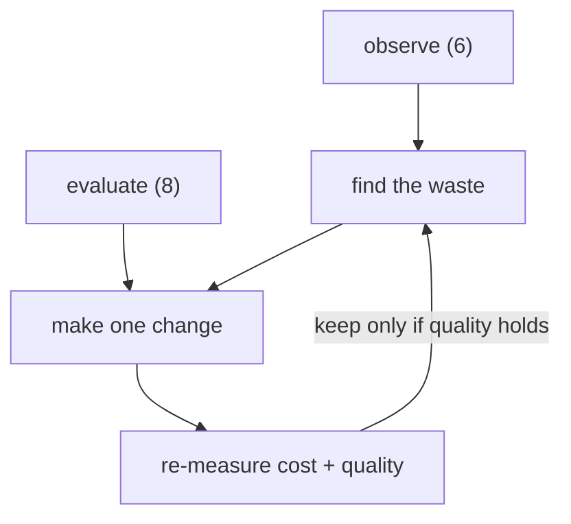
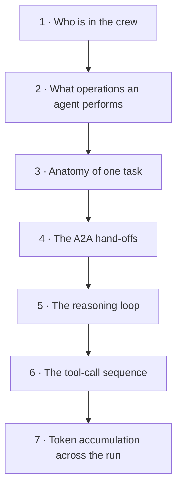

# 9. Optimize

This is where the whole workshop pays off. You can now **run** agents (4),
**secure** them (5), **observe** their cost (6), and **evaluate** their quality
(8). Optimization is the loop that uses that evidence to make agents **cheaper
without making them worse**.

!!! quote "The core idea"
    The biggest driver of AI agent cost is **tokens** — and most token spend is
    waste: unused tools inflating every prompt, oversized system prompts, chatty
    multi-hop workflows, and retries. You can't cut what you can't see, which is
    why observation and evaluation came first.

## The optimization loop



Change one thing, re-run the eval suite, and keep the change **only if quality
holds and cost dropped**. Never optimize on cost alone — that's how you ship a
cheap agent that gives wrong answers.

!!! tip "Three ready-made surfaces — deploy them first"
    This module ships a Dynatrace **read-the-run notebook**, a **dashboard** and a
    **before/after notebook** that compute every signal below from your crew's
    `gen_ai.*` spans. Their DQL filters on `workshop.attendee == "${WORKSHOP_PREFIX}"`
    (module 2), so render them with your prefix, then deploy:

    ```bash
    renderOptimizationAssets      # -> .rendered/optimization/ (YAML for dtctl, JSON for the UI)
    deployOptimizationAssets      # dtctl: read-the-run notebook, dashboard, before/after notebook
    ```

    No platform token in your session? Upload the rendered `.json` files from
    `.rendered/optimization/` in your tenant (**Notebooks / Dashboards / Workflows →
    Upload**). The unrendered originals are in
    [`docs/assets/optimization/`](https://github.com/dynatrace-wwse/workshop-dynatrace-ai-agents/tree/main/docs/assets/optimization) — find/replace
    `${WORKSHOP_PREFIX}` with your prefix before uploading those.

    - **Notebook — *Read an AI Agent Run*** (`ai-agent-workflow-steps`): walks one
      run from the crew list down to the per-hop token bill. Start here.
    - **Dashboard — *AI Agent Optimization***: spend ranking, input:output ratio,
      tool calls, tool coverage, loop detection, token trend.
    - **Notebook — *AI Agent Optimization — before/after***: the observe → find →
      change → re-measure → keep/revert walkthrough, one runnable DQL cell per step.

    All five artifacts (plus the guardian and workflow of §4) are dtctl-ready YAML
    in [`cluster/dynatrace/optimization/`](https://github.com/dynatrace-wwse/workshop-dynatrace-ai-agents/tree/main/cluster/dynatrace/optimization) with a README.

<!-- LAB_QUESTION
type: shell-verification
question: "Verify the optimization assets are rendered with your workshop prefix"
buttonText: "Check assets"
command: "source .devcontainer/util/source_framework.sh >/dev/null 2>&1 && checkOptimizationAssetsRendered"
expect:
  operator: exit-zero
hint: "Run `renderOptimizationAssets` in the Terminal, then check again."
explanation: "Every DQL in the notebooks and dashboard now filters on your workshop.attendee value, so they show only your agents' data."
-->

<!-- LAB_SOLUTION
commands:
  - renderOptimizationAssets
verify:
  - source .devcontainer/util/source_framework.sh >/dev/null 2>&1 && checkOptimizationAssetsRendered
reveal: |
  `renderOptimizationAssets` runs a scoped `envsubst '${WORKSHOP_PREFIX}'` over
  the dtctl YAML and the UI JSON into `.rendered/optimization/` (gitignored).
  `deployOptimizationAssets` then creates the two notebooks and the dashboard
  with dtctl when the session has a platform token.
-->

## Read the workflow before you cut it

Before you *cut* an agent's cost you have to *read* what it is doing. The ranking
and cuts below act on numbers; this section is how you earn the right to trust
those numbers — by walking **one real run** from the outside in, zooming one level
at a time:



!!! tip "Run these in your own tenant"
    All seven queries below are the cells of the **read-the-run notebook**,
    [`ai-agent-workflow-steps.notebook.yaml`](https://github.com/dynatrace-wwse/workshop-dynatrace-ai-agents/blob/main/cluster/dynatrace/optimization/ai-agent-workflow-steps.notebook.yaml)
    (deploy it from the callout above). Each step below names the matching notebook
    section so you can run it against your own crew and page through the run live.

First, the vocabulary these queries use — correct it to whatever *your* crew
emits:

- An **LLM call** (the agent *reasoning*) is a span with
  `gen_ai.operation.name == "generate_content"`. Key on that operation, never on a
  framework span name — some SDK layers wrap each call in an extra span, and the
  operation counts each LLM call exactly once.
- A **tool call** (the agent *acting*) is `gen_ai.operation.name == "execute_tool"`,
  with the tool name in `gen_ai.tool.name`. Drop `gen_ai.tool.name == "(merged
  tools)"` — a Dynatrace span-merge artifact, not a real tool.
- **Tokens** live on `gen_ai.usage.input_tokens` / `gen_ai.usage.output_tokens`
  (carried on the `generate_content` spans).
- One agent's **unit of work** is `gen_ai.task.id` (it stays inside a single
  service). A full **cross-agent run** is `trace.id` — one trace spans the whole
  crew.
- Order events by `start_time` (`timestamp` is null on these spans).

!!! tip "Scope every query to your data"
    The snippets below filter on `endsWith(k8s.cluster.name, "{{DT_SESSION_ID}}")` — your
    per-learner cluster name, which the OpenTelemetry gateway stamps on every span
    (the Enablement App fills in the id; in a Codespace use the value
    `aiwPrefixBanner` prints). The deployed notebook and dashboard filter on the
    equivalent `workshop.attendee == "<your prefix>"`. Drop the filter and a shared
    tenant mixes the whole class's data.

### 1 · Who is in the crew

**What you're seeing:** your agents. Every service in the `kagent` namespace that
actually makes an LLM call is an agent (the `llmCalls > 0` filter drops the
`kagent-controller` plumbing). `llmCalls` is how often it reasoned; `toolCalls`
how often it acted.

```
fetch spans
| filter endsWith(k8s.cluster.name, "{{DT_SESSION_ID}}") and service.namespace == "kagent"
| summarize spans = count(),
    llmCalls = countIf(gen_ai.operation.name == "generate_content"),
    toolCalls = countIf(gen_ai.operation.name == "execute_tool" and gen_ai.tool.name != "(merged tools)"),
    by:{agent = service.name}
| filter llmCalls > 0
| sort llmCalls desc
```

*Notebook: section 1.*

### 2 · What operations an agent performs

**What you're seeing:** the vocabulary. Everything an agent emits falls into a
handful of activities — it **reasons** (`generate_content`), **acts**
(`execute_tool`), and **talks to other agents** (`a2a.*` + `invoke_agent`).
Everything else is the `Other` bucket you can ignore while reading the run.

```
fetch spans
| filter endsWith(k8s.cluster.name, "{{DT_SESSION_ID}}") and service.namespace == "kagent"
| fieldsAdd activity = if(gen_ai.operation.name == "generate_content", "LLM call (generate_content)",
    else: if(gen_ai.operation.name == "execute_tool", "Tool call (execute_tool)",
    else: if(gen_ai.operation.name == "invoke_agent", "Agent invocation (invoke_agent)",
    else: if(startsWith(span.name, "a2a."), "A2A messaging",
    else: "Other (HTTP / framework)"))))
| summarize spans = count(), by:{activity}
| sort spans desc
```

*Notebook: section 2.*

### 3 · Anatomy of one task

**What you're seeing:** one run, step by step. The sub-query picks the task with
the **most `generate_content` hops** (the busiest reasoning loop — the most
interesting example) and joins its spans back on `gen_ai.task.id`. Read
top-to-bottom: an LLM call, then the tools it decided to run, then the next LLM
call. `kagent__NS__<agent>` tools are hand-offs to sub-agents (see step 4).

```
fetch spans
| filter endsWith(k8s.cluster.name, "{{DT_SESSION_ID}}") and service.namespace == "kagent"
| join [
    fetch spans
    | filter endsWith(k8s.cluster.name, "{{DT_SESSION_ID}}") and service.namespace == "kagent" and gen_ai.operation.name == "generate_content"
    | summarize hops = count(), by:{gen_ai.task.id}
    | sort hops desc, gen_ai.task.id asc
    | limit 1
  ], on:{gen_ai.task.id}, kind:inner, fields:{}
| filter gen_ai.operation.name == "generate_content" or gen_ai.operation.name == "execute_tool"
| filter gen_ai.tool.name != "(merged tools)" or isNull(gen_ai.tool.name)
| fieldsAdd durationMs = duration / 1000000
| fields start_time, agent = service.name, step = span.name, operation = gen_ai.operation.name, durationMs
| sort start_time asc
```

*Notebook: section 3.*

### 4 · The A2A hand-offs

**What you're seeing:** the workflow graph. In this crew an agent delegates to
another by calling it **as a tool** named `kagent__NS__<agent>`; stripping that
prefix gives the edge `fromAgent → toAgent`. Hand-offs cross `service.name`, so
they are correlated by `trace.id`, not by a single `gen_ai.task.id`. The
orchestrator is usually the hub that fans work out to the specialists.

```
fetch spans
| filter endsWith(k8s.cluster.name, "{{DT_SESSION_ID}}") and service.namespace == "kagent" and gen_ai.operation.name == "execute_tool"
| filter startsWith(gen_ai.tool.name, "kagent__")
| fieldsAdd callee = replaceString(gen_ai.tool.name, "kagent__NS__", "")
| summarize handoffs = count(), by:{fromAgent = service.name, toAgent = callee}
| sort handoffs desc
```

!!! note "Returns nothing? That's expected unless the BMAD crew has run"
    A2A hand-offs (`kagent__NS__<agent>` tool calls) are only emitted when the
    **`<prefix>-bmad-orchestrator`** delegates to its specialists. The solo `<prefix>-sre-agent` —
    the default k8s-only investigation path — calls only `kagent-tool-server`
    tools and produces **zero** `kagent__` spans by design, so this graph is empty
    until the crew has run. To populate it:

    1. Run the **BMAD crew** (the A2A sample prompt from
       [module 4 §5](4-agents-mcp.md#5-send-a-sample-prompt)) and re-run the query.
    2. Check the **timeframe** — the notebook cell is hard-coded to `now()-7d`;
       widen it or re-run after the crew has executed within the window.
    3. Confirm *any* `kagent__` spans exist at all:
       ```
       fetch spans
       | filter endsWith(k8s.cluster.name, "{{DT_SESSION_ID}}") and service.namespace == "kagent" and startsWith(gen_ai.tool.name, "kagent__")
       | summarize count(), by:{gen_ai.tool.name}
       ```
       No rows means no crew hand-offs have happened yet.

*Notebook: section 4.*

### 5 · The reasoning loop

**What you're seeing:** where a loop re-reads context. Same busiest task as step 3,
but only its `generate_content` hops in order. Watch `inputTokens` climb hop after
hop while `outputTokens` stays small: every hop re-sends the whole growing
conversation back to the model. A flat line means a tight agent; a staircase means
a context that never gets trimmed. That growth is exactly the chatty-workflow lever
in [§2c](#c-fix-chatty-workflows) below.

```
fetch spans
| filter endsWith(k8s.cluster.name, "{{DT_SESSION_ID}}") and service.namespace == "kagent" and gen_ai.operation.name == "generate_content"
| join [
    fetch spans
    | filter endsWith(k8s.cluster.name, "{{DT_SESSION_ID}}") and service.namespace == "kagent" and gen_ai.operation.name == "generate_content"
    | summarize hops = count(), by:{gen_ai.task.id}
    | sort hops desc, gen_ai.task.id asc
    | limit 1
  ], on:{gen_ai.task.id}, kind:inner, fields:{}
| fields start_time, agent = service.name, inputTokens = gen_ai.usage.input_tokens, outputTokens = gen_ai.usage.output_tokens
| sort start_time asc
```

*Notebook: section 5.*

### 6 · The tool-call sequence

**What you're seeing:** what the agent decided to do. Same busiest task, now only
its `execute_tool` spans in order. Each row is a decision the model made between
reasoning hops — a memory lookup, a sub-agent delegation (`kagent__NS__*`), a
diagnostic call. Compare this list against each agent's *granted* tools: tools
that never appear here are the never-called overhead you drop in
[§2a](#a-remove-tools-the-agent-never-uses) below.

```
fetch spans
| filter endsWith(k8s.cluster.name, "{{DT_SESSION_ID}}") and service.namespace == "kagent" and gen_ai.operation.name == "execute_tool" and gen_ai.tool.name != "(merged tools)"
| join [
    fetch spans
    | filter endsWith(k8s.cluster.name, "{{DT_SESSION_ID}}") and service.namespace == "kagent" and gen_ai.operation.name == "generate_content"
    | summarize hops = count(), by:{gen_ai.task.id}
    | sort hops desc, gen_ai.task.id asc
    | limit 1
  ], on:{gen_ai.task.id}, kind:inner, fields:{}
| fieldsAdd durationMs = duration / 1000000
| fields start_time, agent = service.name, tool = gen_ai.tool.name, durationMs
| sort start_time asc
```

*Notebook: section 6.*

### 7 · Token accumulation across the run

**What you're seeing:** the bill, built one hop at a time. Same busiest task, every
`generate_content` hop with its `inputTokens`, `outputTokens`, and `hopCost` (the
two added). Sum the `inputTokens` column and you get the run's input bill — on the
reference tenant that was ~182k input vs ~14k output across 10 hops (≈13:1), with
the last hop costing several times the first purely because the context grew. That
is why trimming the loop (step 5) beats trimming almost anything else.

```
fetch spans
| filter endsWith(k8s.cluster.name, "{{DT_SESSION_ID}}") and service.namespace == "kagent" and gen_ai.operation.name == "generate_content"
| join [
    fetch spans
    | filter endsWith(k8s.cluster.name, "{{DT_SESSION_ID}}") and service.namespace == "kagent" and gen_ai.operation.name == "generate_content"
    | summarize hops = count(), by:{gen_ai.task.id}
    | sort hops desc, gen_ai.task.id asc
    | limit 1
  ], on:{gen_ai.task.id}, kind:inner, fields:{}
| fieldsAdd hopCost = gen_ai.usage.input_tokens + gen_ai.usage.output_tokens
| fields start_time, inputTokens = gen_ai.usage.input_tokens, outputTokens = gen_ai.usage.output_tokens, hopCost
| sort start_time asc
```

*Notebook: section 7.*

With the run read end-to-end, you now know *which* agent to rank first and *why*
its tokens are high. That is the ranking the rest of this page acts on.

## 1. Rank your agents by spend

From Dynatrace AI Observability (module 6), find your most expensive agents —
total tokens and estimated cost per run. Start at the top of that list; a 20%
cut on your priciest agent beats a 50% cut on a rarely-used one.

```
fetch spans
| filter endsWith(k8s.cluster.name, "{{DT_SESSION_ID}}") and service.namespace == "kagent" and isNotNull(gen_ai.usage.output_tokens)
| summarize llmCalls = count(),
    inputTokens  = sum(gen_ai.usage.input_tokens),
    outputTokens = sum(gen_ai.usage.output_tokens),
    by:{agent = service.name}
| fieldsAdd totalTokens = inputTokens + outputTokens,
    inOutRatio      = round(toDouble(inputTokens) / outputTokens, decimals: 1),
    avgInputPerCall = round(toDouble(inputTokens) / llmCalls)
| sort totalTokens desc
```

!!! example "What this looked like on the reference tenant (7-day window)"
    | Agent | Total tokens | in:out ratio | Avg input / call |
    |-------|---:|:---:|---:|
    | `seta_sre_investigator` | 46.2 M | **38 : 1** | **33,180** |
    | `bmad_orchestrator` | 11.8 M | 14 : 1 | 8,762 |
    | `bmad_developer` | 2.7 M | 3 : 1 | 6,191 |

    The whole crew burned **64 M tokens**, and one agent — the SRE investigator —
    is **72%** of it. Note the **input : output ratio**: 38 input tokens for every
    output token means the model re-reads a large context on *every* call. That
    ratio, not the raw total, is your waste compass. Start there.

## 2. The four highest-leverage cuts

### a) Remove tools the agent never uses

Every tool an agent is granted is described in **every** prompt sent to the
model — that's input tokens on every single call, whether the tool is used or
not. In the traces, look at which tools an agent *actually* calls over many runs;
anything never called is pure overhead.

Trim the agent's `toolNames` to only what it uses:

```yaml
# agents/sre/sre-agent.yaml (illustrative)
spec:
  tools:
    - type: McpServer
      mcpServer:
        toolNames:        # ← keep only the tools this agent actually calls
          - list_pods
          - get_logs
          - dql_query
          # dropped: a dozen k8s tools the SRE agent never invoked
```

List the tools the agent *actually* calls straight from the traces, then diff
against its granted set:

```
fetch spans
| filter endsWith(k8s.cluster.name, "{{DT_SESSION_ID}}") and service.namespace == "kagent" and endsWith(service.name, "-sre-agent")
    and gen_ai.operation.name == "execute_tool" and gen_ai.tool.name != "(merged tools)"
| summarize calls = count(), by:{tool = gen_ai.tool.name}
| sort calls desc
```

!!! example "Measure the schema tax directly"
    Each tool is a JSON schema injected into every prompt. On the reference
    tenant one captured `call_llm` request carried **7** tool declarations costing
    **~1,160 input tokens** — about **165 tokens per tool, on every call**. The
    shipped SRE agent (`agents/sre/sre-agent.yaml`) attaches the Dynatrace MCP
    server with **no `toolNames` filter** (every discovered tool) *plus* 15 k8s
    tools. Pin `toolNames` to the handful the traces prove it uses and you reclaim
    those tokens on all 1,357 calls — before touching anything else.

The workshop ships that cut ready-made: `agents/sre/sre-agent-lean.yaml` is the
same agent with the Dynatrace MCP pinned to five tools (`list_problems`,
`execute_dql`, `find_entity_by_name`, `get_kubernetes_events`,
`get_environment_info`) instead of the eight read tools the full agent carries. Apply it, send the same
prompts, and compare input-token counts in Dynatrace:

```bash
applyLeanSreAgent
generateAgentTraffic
```

Fewer tools → smaller prompts → lower cost on *every* call. To revert:
`installAgents`.

<!-- LAB_QUESTION
type: shell-verification
question: "Verify the SRE agent now pins its Dynatrace tools"
buttonText: "Check agent"
command: "source .devcontainer/util/source_framework.sh >/dev/null 2>&1 && checkLeanSreAgent"
expect:
  operator: exit-zero
hint: "Run `applyLeanSreAgent` in the Terminal, then check again."
explanation: "The agent's Dynatrace tool list is pinned — every prompt now carries five tool schemas instead of eight."
-->

<!-- LAB_SOLUTION
commands:
  - applyLeanSreAgent
  - waitForAgentsAccepted
  - generateAgentTraffic
verify:
  - source .devcontainer/util/source_framework.sh >/dev/null 2>&1 && checkLeanSreAgent
reveal: |
  `sre-agent-lean.yaml` differs from `sre-agent.yaml` in one place: a
  `toolNames` list under the `dynatrace-mcp-remote` tool server. kagent then
  sends only those five tool schemas to the model on every call.
-->

#### Tool-coverage lookup — the never-called tools, by name

The query above lists the tools an agent *did* call. The optimization you want
is the **complement**: which granted tools did it **never** call? Those are the
pure-overhead schemas to drop first. Left-join the agent's *granted* tool set
against the tools it actually called, so zero-call tools surface explicitly.

The granted set ships as a lookup table —
[`cluster/dynatrace/optimization/tool-grants.lookup.json`](https://github.com/dynatrace-wwse/workshop-dynatrace-ai-agents/blob/main/cluster/dynatrace/optimization/tool-grants.lookup.json) —
generated from the agents' `toolNames`. The query below embeds the SRE agent's
15 granted Kubernetes tools inline via `data record(...)` (so it's self-contained) and
`lookup`s the traces for each tool's call count; `coalesce(..., 0)` turns a
never-called tool into a `0`, and the `verdict` column flags the drop candidates:

```
data record(tool = "k8s_get_resources"),
     record(tool = "k8s_describe_resource"),
     record(tool = "k8s_get_resource_yaml"),
     record(tool = "k8s_get_pod_logs"),
     record(tool = "k8s_get_events"),
     record(tool = "k8s_get_available_api_resources"),
     record(tool = "k8s_get_cluster_configuration"),
     record(tool = "k8s_check_service_connectivity"),
     record(tool = "k8s_apply_manifest"),
     record(tool = "k8s_patch_resource"),
     record(tool = "k8s_scale"),
     record(tool = "k8s_rollout"),
     record(tool = "k8s_label_resource"),
     record(tool = "k8s_annotate_resource"),
     record(tool = "k8s_execute_command")
| lookup [
    fetch spans
    | filter endsWith(k8s.cluster.name, "{{DT_SESSION_ID}}") and service.namespace == "kagent"
        and endsWith(service.name, "-sre-agent")
        and gen_ai.operation.name == "execute_tool"
        and gen_ai.tool.name != "(merged tools)"
    | summarize calls = count(), by:{tool = gen_ai.tool.name}
  ], sourceField:tool, lookupField:tool, prefix:"called_"
| fieldsAdd calls = coalesce(called_calls, 0)
| fieldsAdd verdict = if(calls == 0, "NEVER CALLED — drop candidate", else: "used")
| fieldsRemove called_tool, called_calls
| sort calls asc
```

The `endsWith(service.name, "-sre-agent")` filter here is **intentional**:
coverage is a per-agent question ("which of *this* agent's granted tools did
*this* agent never call"). To cover another agent, swap the service name and the
`data record(...)` block for that agent's rows from the lookup file. The
dashboard's **Tool coverage** tile and the notebook's **tool-coverage** cell run
exactly this query.

!!! tip "Tool-call count is the headline"
    The dashboard's top row carries a **Tool calls** single-value tile (total
    `execute_tool` spans) right next to LLM calls — so the never-/rarely-used
    angle is visible before you even scroll. A tool with **zero** calls in the
    coverage table is an unconditional drop; a tool with a handful of calls on a
    large sample is a *rarely-used* candidate worth questioning.

### b) Tighten the system prompt

A rambling system prompt is a fixed tax on every request. Shorten it to the
essentials; move examples out unless they measurably improve the eval score.

### c) Fix chatty workflows

In a BMAD run, the span waterfall (module 6) shows how many A2A hops and LLM
calls a task took. Redundant hand-offs, an agent that re-reads context it already
has, or a loop that retries silently all show up as extra `gen_ai` spans. Collapse
the hops that don't earn their tokens.

```
fetch spans
| filter endsWith(k8s.cluster.name, "{{DT_SESSION_ID}}") and service.namespace == "kagent" and isNotNull(gen_ai.usage.input_tokens)
| summarize llmCalls = count(), inputTokens = sum(gen_ai.usage.input_tokens),
    by:{agent = service.name, task = gen_ai.task.id}
| filter llmCalls >= 5
| sort inputTokens desc
```

!!! example "Loops are where big agents actually bleed"
    On the reference tenant the SRE investigator's heaviest task made **7
    `call_llm` hops and re-sent 228,000 input tokens** — the same growing context
    pushed to the model again and again. For an already-lean agent (few tools,
    tight prompt) this loop re-send, *not* unused tools, is the dominant cost. The
    dashboard's **loop table** ranks these so you fix the worst first.

### d) Right-size the model per agent

Not every agent needs the most capable model. kagent makes the model a
one-line `ModelConfig` reference, so you can point a cheap, mechanical agent
(e.g. a formatter) at a smaller/cheaper model while the reasoning-heavy
orchestrator keeps the stronger one. This workshop already defaults the whole
crew to **DeepSeek** for cost; per-agent tuning goes further.

```yaml
# agents/mcp/00-modelconfig.yaml — the shared workshop-llm (DeepSeek, cost-first)
# Create a second, cheaper ModelConfig and reference it from the agents that
# don't need the strong model. One field per agent: spec.modelConfig.
```

## 3. Prove the win

Open the **before/after notebook** (deployed above). Its §5 cell measures the one
number that moves — average input tokens per LLM call, **per agent** — and the
section time-picker is how you switch the *before* and *after* windows. Read the
row of the agent you changed:

```
fetch spans
| filter endsWith(k8s.cluster.name, "{{DT_SESSION_ID}}") and service.namespace == "kagent" and isNotNull(gen_ai.usage.input_tokens)
| summarize llmCalls = count(),
    avgInputPerCall    = round(avg(gen_ai.usage.input_tokens)),
    medianInputPerCall = round(median(gen_ai.usage.input_tokens)),
    totalInputTokens   = sum(gen_ai.usage.input_tokens), by:{service.name}
| sort avgInputPerCall desc
```

The procedure, in order:

1. Run the query over a window *before* the change — record `avgInputPerCall`.
2. Make **one** change (trim tools / tighten prompt / collapse hops / right-size model).
3. Re-apply and replay the **same** prompts.
4. Run the query over the *after* window and run the dt-evals suite (module 8).

Fill the scorecard from those two runs:

| Metric | Before | After | Keep? |
|--------|:---:|:---:|:---:|
| Avg input tokens / call | *(§5 notebook)* | *(§5 notebook)* | — |
| Est. cost / task | — | — | — |
| Eval pass rate | *(module 8)* | *(module 8)* | ✅ only if ≥ before |

!!! success "The rule"
    Ship the change when **cost went down and the eval pass rate did not**. If
    quality dropped, revert — the cheaper agent that's wrong is more expensive
    than the costly one that's right.

## 4. Make it continuous — the guardian + workflow

Optimization isn't a one-off. Because cost and quality are now both telemetry,
the workshop ships two more dtctl-ready artifacts in
[`cluster/dynatrace/optimization/`](https://github.com/dynatrace-wwse/workshop-dynatrace-ai-agents/tree/main/cluster/dynatrace/optimization)
that turn the optimization loop into an automated gate:

**A Site Reliability Guardian** (`ai-agent-quality-cost.guardian.yaml`) — three
DQL objectives over the crew's `call_llm` spans, so a regression fails loudly:

| Objective | SLI | Rule | target / warning |
|-----------|-----|------|------------------|
| Cost per LLM call | avg input tokens / call | `≤` | 20,000 / 18,000 |
| Loop efficiency | avg hops / task | `≤` | 5 / 4 |
| Answer substance (quality proxy) | avg output tokens / call | `≥` | 200 / 300 |

```bash
cd .rendered/optimization        # after renderOptimizationAssets
dtctl create settings -f ai-agent-quality-cost.guardian.yaml \
  --schema app:dynatrace.site.reliability.guardian:guardians --scope environment
```

The quality proxy backstops the cost cuts — an agent that got "cheaper" by
emitting truncated answers trips it. For the full **LLM-judge** quality gate,
pair the guardian with the dt-evals suite (module 8).

**A scheduled Workflow** (`ai-agent-optimization.workflow.yaml`) runs that
guardian daily over the last 24h (schedule ships disabled — flip
`trigger.schedule.isActive: true` to go continuous):

```bash
dtctl create workflow -f ai-agent-optimization.workflow.yaml
```

No `dtctl`? Upload `.rendered/optimization/ai-agent-optimization.workflow.json`
from **Workflows → Upload**. It carries the reference tenant's guardian `objectId` —
after you create your own guardian, repoint it:
`dtctl get settings --schema app:dynatrace.site.reliability.guardian:guardians -o json --plain | grep -B2 "AI Agent Quality"`
gives the new `objectId`; paste it into `tasks.run_validation.input.objectId`.

Beyond the guardian:

- Keep the dt-evals suite in CI as a **regression + budget gate** on every agent
  change.
- Watch the dashboard's **token-trend** tile; the guardian alerts when an
  agent's tokens-per-call drifts up.
- Re-rank your agents periodically — usage patterns change, and today's cheap
  agent is tomorrow's top spender.

## What you achieved (acceptance)

- You identified the most expensive agents from real telemetry.
- You applied at least one concrete cut (unused tools / prompt / hops / model)
  and **proved** with evals that quality held while cost fell.
- You have a repeatable loop — observe → evaluate → change → re-measure — to keep
  agents cost-efficient in production.

<!-- LAB_QUESTION
type: multiple-choice
question: "You trimmed tools and input tokens per call fell 40%, but the eval pass rate dropped from 4/4 to 2/4. What do you do?"
options:
  - "Revert the change: a cheaper agent that is wrong more often costs more than one that is right"
  - "Ship it — cost is the goal of this module"
  - "Keep it and lower the eval threshold to 2/4"
  - "Switch to a larger model and keep the trimmed tools without re-measuring"
correct: 0
explanation: "The rule of the loop: keep a change only if cost went down AND the eval pass rate did not."
-->

## You've completed the arc

**Why → kagent → cluster → agents → secure → observe → diagnose → evaluate → optimize.**
You built a full, cost-efficient AI-agent platform on Kubernetes and have the
telemetry and evals to keep it that way.

Stuck on anything? See **[Troubleshooting](troubleshooting.md)**.
