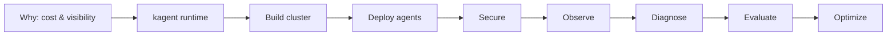

# Dynatrace AI Agent Workshop

!!! info "Credits"
    This workshop was created by **Henrik Rexed** (Dynatrace, [Is It Observable](https://isitobservable.io))
    — originally [`henrikrexed/dynatrace-AI-Agent-Workshop`](https://github.com/henrikrexed/dynatrace-AI-Agent-Workshop) —
    and migrated to the Dynatrace enablement framework so it runs in the
    Enablement App with quizzes, checks and self-solving steps.

AI agents are evolving fast, but many organizations still struggle with rising
costs, limited visibility, and unreliable performance in production.

In this hands-on workshop you'll design, deploy, and optimize **cost-efficient AI
agent workflows** using **BMAD, kagent, Kubernetes, and Dynatrace AI
Observability** — all inside one environment with a local Kubernetes cluster.

## What you'll learn

- Control the biggest driver of AI agent costs.
- Build structured multi-agent workflows with BMAD.
- Deploy AI agents on Kubernetes using kagent.
- Secure agents with Tetragon and Agent Sandbox.
- Monitor cost, performance, and efficiency with Dynatrace AI Observability.
- Evaluate agents with Phoenix + dt-evals, then optimize the inefficient ones.

## Workshop arc

1. **Why** — cost, visibility, reliability of AI agents in production.
2. **kagent intro** — the agentic runtime on Kubernetes.
3. **Meet the platform** — operators, kagent, Phoenix, the LLM backend.
4. **Deploy two agent sets** — an SRE agent + the BMAD software-building crew.
5. **Secure agents** — Tetragon runtime security + Agent Sandbox.
6. **Observe** — Dynatrace AI Observability.
7. **Diagnose** — inject a fault, let the agent find the root cause.
8. **Evaluate** — Phoenix (Arize) + dt-evals.
9. **Optimize** — find unused tools/skills and cut token spend.

## Start here

New to kagent? Read **[1. kagent in 5 minutes](1-kagent-in-5-minutes.md)** for
the mental model, then continue in order. Every hands-on step has a check, and
every step can solve itself (trainers: *Run solution*).

| Module | Time | You need |
|---|---|---|
| 1. kagent in 5 minutes | 5 min | — |
| 2. Setup | 5 min | — |
| 3. Platform install | 10 min | — |
| 4. Agents & MCP | 20 min | — |
| 5. Secure | 20 min | — (Tetragon needs a Codespace kernel) |
| 6. Observe | 25 min | Dynatrace tenant (injected in the Enablement App) |
| 7. Diagnose | 40 min | — |
| 8. Evaluate | 30 min | Part C: nothing · Parts A/B: an LLM judge key |
| 9. Optimize | 30 min | Dynatrace tenant |

Running it live? The **[Run of show](run-of-show.md)** stitches the modules into
one 13-step script. Stuck? See **[Troubleshooting](troubleshooting.md)**.

<!-- LAB_QUESTION
type: multiple-choice
question: "What is the biggest driver of AI agent cost that this workshop teaches you to cut?"
options:
  - "Kubernetes node hours"
  - "The number of agents deployed"
  - "Tokens — especially input tokens re-sent on every call"
  - "OpenTelemetry ingest volume"
correct: 2
explanation: "Tokens drive the bill, and most of them are input: tool schemas, system prompts and growing context re-sent on every call."
-->

<!-- LAB_NO_SOLUTION: introduction — nothing in the environment changes -->

- [1. kagent in 5 minutes :octicons-arrow-right-24:](1-kagent-in-5-minutes.md)

